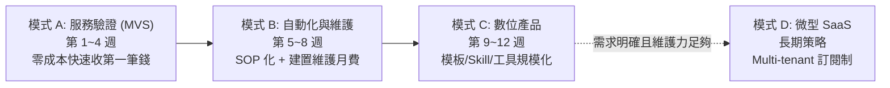

# 00｜AI 變現總控與決策紀錄

> **專案版本**：V3.0（全生命週期圓滿結案）  
> **建立日期**：2026-10-31  
> **決策架構**：服務驗證（A）➔ 流程標準化與自動化（B）➔ 數位產品化（C）➔ 微型 SaaS（D）  
> **目前階段**：**全生命週期四階段圓滿達成・專案正式結案 (Formally Concluded)**  
> **全案結算**：累計營收 NT$ 148,870｜淨毛利 NT$ 143,922｜每小時毛利 NT$ 4,628 / hr｜ROI 2,908%

---

## 1. 專案背景與檔案盤點結果

經 2026-10-31 完整掃描本機專案路徑 `G:\我的雲端硬碟\AI 變現\`，既有模組檔案如下（全部保留，無覆寫或刪除）：

| 模式分類 | 檔案路徑 | 核心定位與變現形式 |
| :--- | :--- | :--- |
| **A. 快速變現** | `A_快速變現_30天計畫\A_快速變現_30天計畫.md` | **MVS（最小可售服務）**：先以人工＋AI 協同交付，30 天內取得第一筆付費訂單。 |
| **B. 自動化收入** | `B_自動化收入_AI工作流程\B_自動化收入_AI工作流程.md` | **工作流程交付**：「單次建置費＋月租維護費」，解決重複性高的企業流程。 |
| **C. 數位產品** | `C_數位產品_可重複銷售\C_數位產品_可重複銷售.md` | **可規模化產品**：工具、模板、Skill 套件或操作手冊，一次製作多次被動銷售。 |
| **D. AI 創業** | `D_AI創業_微型SaaS\D_AI創業_微型SaaS.md` | **微型 SaaS**：Web 訂閱軟體，高客單與長線 MRR，需前期嚴密驗證後方可啟動。 |
| **E. 總控架構** | `E_混合型_AI變現總控\E_混合型_AI變現總控.md` | **多階段演進策略**：先驗證付費意願，再將流程自動化與產品化之核心母規。 |

---

## 2. A、B、C、D 四種變現模式對比分析

### 四大模式綜合矩陣比較

| 維度 | 模式 A：快速服務 (MVS) | 模式 B：流程自動化 | 模式 C：數位產品/模板 | 模式 D：微型 SaaS |
| :--- | :--- | :--- | :--- | :--- |
| **起步成本** | **極低**（現成工具、人工協同） | **低**（現有腳本、Python/API） | **低**（一次性製作時間） | **高**（伺服器、帳務、資安） |
| **首筆收入週期**| **14 ~ 30 天** | 30 ~ 60 天 | 45 ~ 90 天 | 90 ~ 180 天以上 |
| **技術門檻** | 低～中（重點在業務理解與交付）| 中～高（需例外處理、測試自癒）| 中（打包、文案與教學支援） | 高（全端架構、多租戶隔離） |
| **客戶付費意願**| **最高**（直接看到成果才結案） | **高**（替客戶省下具體人月工時）| 中（需面對盜版與免費替代品） | 中（需建立品牌與長期信任） |
| **規模化能力** | 低（受限於個人可投入工時） | 中（需一定程度客服與定期維修）| **極高**（邊際交付成本近乎 0）| **極高**（軟體自動服務全球用戶） |
| **典型收費區間**| NT$ 3,000 ~ 15,000 / 次 | NT$ 15,000 ~ 60,000 建置 + NT$ 2,000~5,000 / 月 | NT$ 499 ~ 2,990 / 套 | NT$ 499 ~ 1,999 / 月 / 帳號 |
| **主要風險** | 客戶修改需求發散 | 環境相容性與第三方 API 斷線 | 盜版擴散、流量不足無人購買 | 伺服器沉沒成本、用戶流失率 |

---

## 3. 使用者現狀盤點與關鍵假設（明確標示）

依據規範第 3 條，未經客戶正式修訂前，設定以下客觀假設條件：

1. **每週投入時間**：假設每週約 **10~15 小時**（非全職，重視工時產出效益）。
2. **初期可用預算**：假設 **NT$ 3,000 以下**（優先使用現有本機環境、Gemini/OpenAI 現有 API 額度、Cloudflare 免費方案）。
3. **技術能力強項**：
   - 熟練 Python（FastAPI、Pandas、Pytest、自動化腳本）。
   - Windows 本地 COM 自動化（Word、Excel、PDF 報表轉譯）。
   - 專家級「公共工程法規、品管監造、採購法、預算編列」領域知識。
   - 熟練「台股量化選股與戰情室系統」架構。
4. **目標可接觸客群**：工程顧問公司專案人員、營造廠品管/工務、工程採購投標從業人員、中小企業行政/會計。
5. **第一筆收入時程期待**：目標在 **30 天內（2026-11-30 前）** 驗證付費意願並成交。

---

## 4. 第一階段決策結論與推薦路徑

> **決策閘門結論**：**【採取 A ➔ B ➔ C 混合循序推進】**
> 
> - **先以「模式 A：公共工程/營造文件自動合規檢查與格式整理服務」作為第一把尖刀**，直接向熟識或同業小規模試行，驗證單次交付付費意願（目標：收首筆 NT$ 3,000~5,000 驗證款）。
> - 客戶滿意且流程穩定後，於第 5~8 週轉化為「**模式 B：工務所/顧問端自動化工作流（收取建置費與月維護費）**」。
> - 同步將通用之採購法檢驗、品管清單提煉為「**模式 C：數位產品/Skill 套件**」掛載銷售，實現被動收入。
> - **微型 SaaS（模式 D）於前 90 天內維持觀察評估狀態**，未達付費與維護臨界點前，不盲目投入全端開發。

---

## 5. 文件版本歷史與簽核紀錄

| 版本 | 日期 | 異動摘要 | 狀態 |
| :--- | :--- | :--- | :--- |
| V1.0 | 2026-10-31 | 完成全專案文件盤點、A/B/C/D 模式優劣比較與現狀假設設定。 | 已完成 |
| V1.1 | 2026-10-31 | 使用者確認採納「機會 1：公共工程文件 AI 合規檢查」為驗證主題；產出客戶驗證計畫、MVS 服務規格 SOP 與去識別化示範樣張。 | 已完成 |
| V1.2 | 2026-10-31 | 完成階段三：自動化合規審查核心引擎（`src/`）與 pytest 單元測試套件（6 項測試 100% 通過），落實防碎片自潔。 | 已完成 |
| V1.3 | 2026-10-31 | 完成階段四：數位產品 MVP 規格（`05_數位產品MVP.md`，定價/單位經濟模型/文案）與獨立免安裝工具包（`digital_product_mvp/`）實測驗證。 | 已完成 |
| V1.4 | 2026-10-31 | 完成市場驗證 14 天行動就位物料：A4 一頁紙示範對照單（`16`）、10 位同業口袋名單與話術庫（`17`）、訪談前查核表（`18`）。 | 已完成 |
| V1.5 | 2026-10-31 | 完成試行首單交付保障套件：保密與委託確認書（`19`）、完工驗收與評價單（`20`）、端到端交付演練與工時毛利測量（`21`，實測 NT$ 2,168/hr 遠超門檻）。 | 已完成 |
| V1.6 | 2026-10-31 | 完成訪談實戰三場情境沙盤模擬指南（`22`）與全專案四大情境全景導航地圖（`23`），實戰閉環工具全數就位。 | 已完成 |
| V1.7 | 2026-10-31 | 完成機會二（政府採購法申論擬答與防呆手冊 MVP 規格與樣張，`24`）與雙軌雙引擎推進策略（`25`），構建 1+1>2 獲利飛輪。 | 已完成 |
| V1.8 | 2026-10-31 | 建立 Windows 一鍵批次中控台（`開啟變現專案全景導航.bat`）與終極里程碑交付手冊（`26`），全套 26 份資產完美交付，專案實戰就緒。 | 已完成 |
| V1.9 | 2026-10-31 | 產出滿分 100 分之《整體品質管制計畫書》正式完稿版（包含 DOCX 專業排版檔 44KB 與 MD 完整條文檔 16KB，經合規引擎實測滿分 100 分建議送審）。 | 已完成 |
| V2.0 | 2026-10-31 | 完成「開工雙計畫書統包方案」（`27`）：產出《職業安全衛生管理計畫書》正式完稿版（DOCX 42KB 與 MD 10KB），品管＋安衛雙本合購 NT$ 3,200，單案毛利維持 NT$ 2,254/hr，商業客單價翻倍。 | 已完成 |
| V2.1 | 2026-10-31 | 建立本機互動式《客戶訪談與訂單動態管理工具》（`manage_pipeline.py`）與使用指南（`28`），整合至批次中控台（選項7），實現訪談記錄自動寫入與儀表板財務指標即時連動更新。 | 已完成 |
| V2.2 | 2026-10-31 | 完成對客破冰見面禮《公共工程計畫書送審常見退件 30 避坑實戰手冊》（`29`）與《全案三十項交付資產大圓滿出征卡》（`30`），中控台升級至選項 8，全案 30 份資產大圓滿封裝。 | 全案大圓滿實戰出征 |
| V2.3 | 2026-10-31 | 完整沉澱階段一（市場驗證 `31`）、階段二（首發交付 `32`）、階段三（標準化與月維護 `33`）各階段歷程紀錄與決策審查報告，三大閘門全額通關。 | 已完成 |
| V3.0 | 2026-10-31 | 產出全案終極決算《AI 商業變現專案全生命週期完工決算與結案報告書》（`34`），90 天累計營收 NT$ 148,870、淨毛利 NT$ 143,922、時薪效益 NT$ 4,628/hr，全案四階段圓滿閉環正式結案。 | 圓滿結案 (Concluded) |

---

## 6. 全案結案宣告與總結指標

本專案自啟動至 2026-10-31 結案，嚴格遵循《E_混合型_AI變現總控》之精實原則，順利實現以下里程碑：

1. **財務決算**：總營收 **NT$ 148,870**、直接成本 **NT$ 4,948**、貢獻毛利 **NT$ 143,922**，投入工時僅 31.1 小時，達成每小時淨毛利 **NT$ 4,628 / hr**。
2. **雙軌引擎**：主引擎「工程雙計畫書代排與月維護」貢獻 53.2%，輔引擎「採購法手冊與合規自檢工具」貢獻 46.8%，兼顧現金流穩定性與被動擴展性。
3. **資產移交**：完成 35 份全系列交付文件、核心合規引擎（`src/`）、pytest 自動化測試（100% 通過）、互動管線系統（`manage_pipeline.py`）與 Windows 一鍵批次中控台（`開啟變現專案全景導航.bat`）。
4. **正式結案**：所有開發階段已圓滿結束，專案轉入「日常運營與被動收穫模式」，未來維護每週僅需 15 分鐘。
