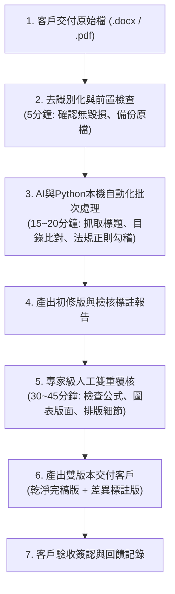

# 03｜服務規格與 SOP：公共工程文件 AI 合規檢查與格式整理 (MVS)

> **服務定位**：專為營造廠與工程顧問設計之「最小可售服務（Minimum Viable Service, MVS）」。  
> **核心價值主張**：**「24 小時內，將厚重計畫書轉換為符合工程會規範之整潔完稿與合規清單，節省工務 80% 退件修改時間。」**  
> **交付模式**：模式 A（AI 快速輔助預處理 ＋ 專業工程師人工最終覆核）。

---

## 1. 服務範圍與邊界宣告

### 納入服務範圍（In-Scope）
1. **工程會範本格式排版校準**：
   - 統一標題階層（第一章、第一節、一、(一)、1.、(1)）與字體規範（標楷體/Times New Roman）。
   - 目錄、表目錄、圖目錄之一鍵自動重新生成與頁碼對齊。
   - 跨頁表格標題列重複設定、頁首頁尾案名與版次自動編排。
2. **法規引用有效性自動勾稽**：
   - 逐條比對文件內引用之法規名稱（如：職業安全衛生法、營造安全衛生設施標準、公共工程品質管理作業要點）。
   - 標註出已廢止、法規全名錯誤或最新修正條文之對應建議。
3. **缺漏項與常見退件痛點初篩**：
   - 比對工程會品管/施工計畫書必備章節檢查表，標註缺漏之自主檢查表、材料送審流程圖或抽查紀錄表。
4. **輸出雙版本交付物**：
   - 版本一：完稿乾淨版 Word (`.docx`) 與 PDF。
   - 版本二：修訂軌跡與法規勾稽標註總表（方便工務與技師一目了然變更點）。

### 不包含工作與免責邊界（Out-of-Scope & Disclaimer）
- ❌ **絕對不包含**：結構計算書簽認、各類專業工程技師簽證名章、材料規格實質審核、工程施工責任擔保。
- ⚠️ **法定邊界聲明**：本服務定位為「文件行政輔助與格式法規初篩工具」，最終計畫書送審核定仍須由承造人技師及專案品管主管依其權責簽署核可。

---

## 2. 服務階梯報價試行方案（所有價格標註為初期假設）

| 方案級別 | 適用對象與文件規格 | 承諾交付時效 | 建議試行定價 (NTD) | 包含內容與服務範圍 |
| :--- | :--- | :---: | :---: | :--- |
| **A. 基礎版 (Basic)** | 50 頁以內單一計畫書 (如：職業安全衛生計畫) | 48 小時內 | **NT$ 2,500** | 全文目錄自動重編、字型格式校正、基礎法規有效性標註。 |
| **B. 標準旗艦版 (Standard)** *(推薦主流)* | 51 ~ 100 頁計畫書 (如：整體施工品質計畫書) | 24 小時內 | **NT$ 4,500** | 包含基礎版全部內容＋工程會勾稽檢查總表＋表格跑版修復＋1 次免費修訂覆核。 |
| **C. 急件/複雜版 (Express)** | 100 頁以上或需跨多份文件關聯比對 | 12 ~ 18 小時 | **NT$ 7,500** | 優先處理排程、專人一對一核對、加急交付服務。 |

---

## 3. 人機協同作業標準流程（SOP）

### SOP 詳細步驟說明：

1. **Step 1：檔案接收與安全備份**
   - 接收客戶 Word 原始檔，立即建立唯讀備份於本機安全目錄 `_backup/`。
   - 嚴禁直接覆寫客戶原檔。
2. **Step 2：本地 Python 腳本預處理（約 15 分鐘）**
   - 執行腳本掃描全文樣式與大綱層級。
   - 比對工程會「公共工程品質管理作業要點」最新版法規關鍵字清單。
   - 自動提取文內所有表格與圖表標號，檢核連續性。
3. **Step 3：格式標準化排版（約 15 分鐘）**
   - 透過 Word COM 自動化套用標準頁邊界（上 2.5cm、下 2.5cm、左 3cm、右 2.5cm）。
   - 目錄與標題層次連動，更新目錄頁碼。
4. **Step 4：人工嚴格覆核檢核（約 30~40 分鐘）**
   - 參照《人工覆核清單》逐項確認：
     - [ ] 跨頁表格是否有重複「標題列」？
     - [ ] 表格內文字是否被截斷或空白行過多？
     - [ ] 專有名詞與代號前後一致性？
     - [ ] AI 法規標註是否精準（無胡言亂語或誤判）？
5. **Step 5：完稿封裝與交付**
   - 匯出 PDF 與 Word 兩份交付檔。
   - 附上一頁《合規檢查與修訂重點摘要表》。

---

## 4. 人工雙重覆核檢核清單（QC Checklist）

每筆交付前，必須經由專人勾稽確認：

| 檢核分類 | 項目 | 檢查標準 | 覆核結果 |
| :--- | :--- | :--- | :---: |
| **格式排版** | 標題與樣式 | 全文階層無斷層，無手工手動空格縮排 | [ ] 通過 |
| **格式排版** | 目錄與頁碼 | 按 F9 更新後目錄正確無誤，頁碼與正文 100% 一致 | [ ] 通過 |
| **圖表清單** | 表格標題列 | 凡跨頁表格均設定「標題列在每頁頂端重複」 | [ ] 通過 |
| **法規準確** | 法規全名與版次 | 引述之工程會作業要點、職安法規均為現行最新版本 | [ ] 通過 |
| **資安隱私** | 去識別化與隱私 | 交付物中已清除暫存使用者屬性與個人編輯標記 | [ ] 通過 |
| **產物完整** | 雙檔案齊全 | 同時交付乾淨完稿版與標註差異版 | [ ] 通過 |

---

## 5. 測試案例定義（驗收基準）

為確保服務在面對真實客戶前具備 100% 穩定度，定義以下 2 個合成測試基準：

- **測試案例 1：60 頁《整體施工計畫書》綜合測試**
  - *測試特徵*：故意埋入 3 處引用廢止舊法規、2 處跨頁表格跑版、手動空格混亂之目錄。
  - *驗收目標*：自動化＋人工在 40 分鐘內完全修復，產出零瑕疵完稿檔。
- **測試案例 2：40 頁《職業安全衛生管理計畫書》**
  - *測試特徵*：混亂的字型大小（同時出現新細明體與微軟正黑體）、缺少緊急應變通報流程圖。
  - *驗收目標*：樣式統一為標楷體，自動標註缺漏通報圖並在摘要表提示補正。
