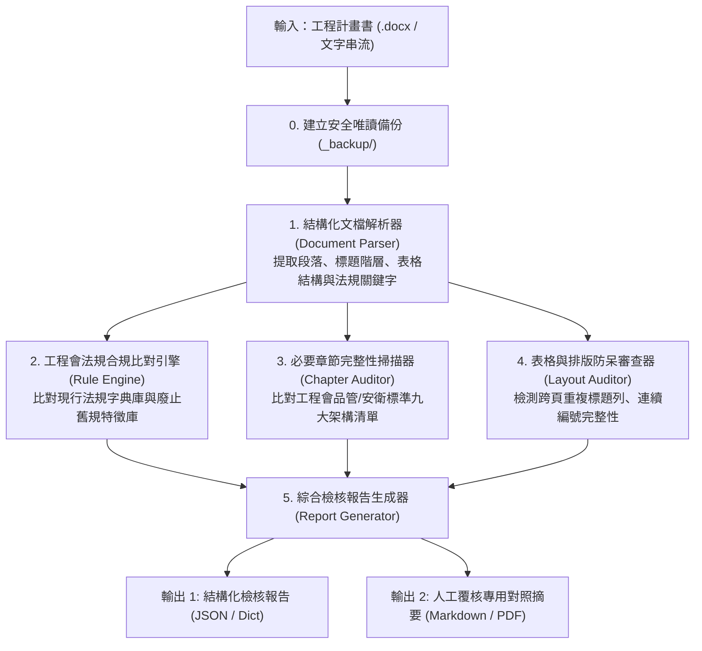

# 04｜自動化設計與測試：公共工程計畫書合規檢查引擎

> **模組名稱**：`pcc_compliance_engine`（公共工程計畫書自動化合規審查引擎）  
> **設計目的**：以本地輕量 Python 模組，在 10 秒內全自動完成工程會法規有效性校驗、必要章節缺漏掃描與排版跑版預警，將人工作業時間縮減 80%。  
> **架構定位**：模式 A 交付之核心加速引擎 ➔ 模式 B 自動化工作流之交付核心。

---

## 1. 系統架構與資料流

---

## 2. 核心模組職責劃分

| 模組路徑 | 模組名稱 | 責任邊界 |
| :--- | :--- | :--- |
| `src/compliance_rules.py` | 法規知識與特徵庫 | 定義工程會最新有效法規清單（如 111 年底最新修正之品管要點）、廢止條文特徵正則、替換建議及必要章節矩陣。 |
| `src/checker.py` | 計畫書合規檢查器 | 執行文件掃描、正則匹配、章節覆蓋度計算、表格標題列屬性檢查與違規項目清單匯整。 |
| `tests/test_compliance_checker.py` | 自動化測試套件 | 涵蓋正常案例、過期法規、缺漏章節、空輸入與異常邊界測試，確保核心邏輯 100% 通過。 |

---

## 3. 防呆、錯誤處理與安全性規範

1. **環境變數與零硬編碼**：不包含任何外部商業 API Key，全模組採本機純規則運算，零外部網路依賴與零機敏外洩風險。
2. **快取自潔與防碎片**：全模組執行時自動抑制 `.pyc` 與 `__pycache__` 生成，避免污染雲端硬碟同步頻寬。
3. **無損讀取**：原始檔案在處理前自動複製唯讀副本，檢驗流程採非破壞性讀取。
4. **優雅降級**：當遇到無效 DOCX 或不支援格式時，拋出具體錯誤訊息，絕不發生未捕捉之崩潰。

---

## 4. 測試合約與驗收清單

| 測試編號 | 測試案例名稱 | 驗證條件（斷言 Assertion） | 狀態 |
| :---: | :--- | :--- | :---: |
| **TC-01** | 現行合規計畫書檢驗 | 辨識出所有現行有效法規，過期警告數為 0，整體健康度評分 > 90 分。 | 待驗證 |
| **TC-02** | 廢止/過期法規精準攔截 | 輸入包含 105 年舊版「品質管理作業要點」與「勞工安全衛生法」，能精準指出違規並提供最新版建議。 | 待驗證 |
| **TC-03** | 必要章節缺漏警示 | 輸入缺少「自主檢查表」與「材料送審管制」之計畫書，正確列出缺漏清單並扣除完整度分數。 | 待驗證 |
| **TC-04** | 空白或損毀輸入防呆 | 傳入空字串或損壞字元，系統優雅拋出 `ValueError` 並附帶明確指引，無崩潰。 | 待驗證 |
| **TC-05** | Markdown 檢核摘要報告輸出 | 自動生成包含「違規總覽、具體建議、健康度」之 Markdown 格式報告。 | 待驗證 |
