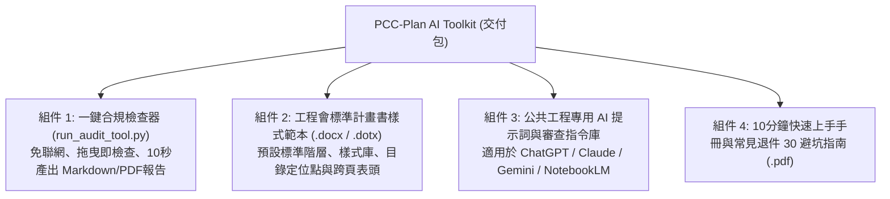

# 05｜數位產品 MVP 規格與定價試算：公共工程 AI 合規加速工具包

> **產品名稱**：**《公共工程計畫書 AI 合規與排版加速工具包》（PCC-Plan AI Toolkit）**  
> **產品版本**：V1.0 MVP  
> **核心價值主張**：**「買一次、永久用！一鍵秒抓廢止舊法規與章節缺漏，讓工務所再也不被監造退件。」**  
> **變現模式**：模式 C（可規模化、零邊際交付成本之數位產品 / Gumroad / 官網直購）。

---

## 1. 產品組成與交付包架構（Delivery Package）

本數位產品採「免安裝、即開即用」設計，客戶購買後將獲得包含以下 4 大組件之 ZIP 封裝包：



---

## 2. 目標客群與使用情境

| 客群分類 | 痛點情境 | 購買動力 |
| :--- | :--- | :--- |
| **現場工務工程師** | 剛接新案場，白天忙工地現場，晚上熬夜趕幾百頁計畫書，頻繁被監造退件。 | 省下 80% 手工排版與校對時間，避免被所長責怪。 |
| **中小型營造廠負責人** | 沒有專職行政美編，聘請專人成本高，外包一次幾千元心疼。 | 買一套供全工務所多個標案重複使用，性價比極高。 |
| **獨立執業土木/結構技師** | 需審閱多家承包商送審之計畫書，需要快速初篩防呆工具避免簽證疏失。 | 作為案頭必備的查核篩子，過濾基礎低級錯誤。 |

---

## 3. 定價策略與單位經濟試算（Unit Economics）

> [!NOTE]
> 所有定價、轉換率與銷售量均為初期財務模型假設，用於評估損益兩平點。

### 三種階梯授權方案

| 方案 | 建議定價 (NTD) | 授權範圍 | 包含內容與售後支援 |
| :--- | :---: | :--- | :--- |
| **個人版 (Starter)** | **NT$ 790** | 單一工程師個人使用（限 1 台裝置） | 包含核心檢查工具、基礎樣式範本、電子版手冊。純自助手冊，不含一對一定制。 |
| **專業工程師版 (Pro)** *(推薦)* | **NT$ 1,490** | 個人商業使用（不限個人裝置） | 包含個人版全部內容＋工程會完整九大章節範本＋AI 提示詞全套＋享 1 年法規更新。 |
| **工務所團隊版 (Site License)** | **NT$ 4,990** | 單一標案工務所全員授權（最多 5 人） | 包含專業版全部內容＋可開立報帳用三聯式發票＋1 次 30 分鐘線上遠端配置諮詢。 |

---

### 單位經濟效益分析（以「專業工程師版 NT$ 1,490」為基準）

假設透過 Gumroad、綠界或自建網站銷售：

- **單筆毛利拆解**：
  - 產品售價：**NT$ 1,490**
  - 第三方金流手續費（約 5%）：NT$ 75
  - 雲端下載與平台維護費（邊際成本）：NT$ 15
  - 每筆淨貢獻毛利（Contribution Margin）：**NT$ 1,400**（毛利率達 **94%**！）
- **損益兩平分析**：
  - 初期開發與測試總投入成本：約 NT$ 4,500（行銷廣告與材料製作）
  - **損益兩平銷量（Break-even Volume）**：只需要賣出 **4 套** 專業版即完全回本！
  - 若每月售出 15 套，可產生每月被動淨現金流約 **NT$ 21,000**。

---

## 4. 上架文案與銷售頁草稿（Sales Pitch）

```markdown
# 標題：再也不怕被監造退件！公共工程計畫書 AI 合規與排版加速工具包 🚀

你是否也曾為了送審一本施工計畫書，改到半夜兩點？
好不容易排好版，送去監造單位卻被一句：
「法規引用民國 105 年舊版」、「表格跨頁沒有表頭」、「目錄頁碼對不起來」當場退件！

開工期限迫在眉睫，退件一次就延遲請款，甚至面臨工程會查核扣點？

### 💡 專為台灣公共工程量身打造的解法來了！
我們將 20 年公共工程審查規範與自動化技術，濃縮為《公共工程計畫書 AI 合規加速工具包》：

✅ **10秒光速診斷**：拖入 Word 檔，自動揪出引用廢止舊法規與章節缺漏。
✅ **工程會標準版型**：一鍵載入標準大綱與樣式，目錄、圖表清單 100% 齊平不跑版。
✅ **零技術門檻**：內建免安裝執行腳本，完全本機運算，工程機敏個資不外洩！
✅ **雙重安全保障**：隨附工程會最新九大章節標準範本與退件避坑檢核表。

原價 NT$ 2,990，早鳥首發推廣限時特惠 **NT$ 1,490**！
省下一晚熬夜加班的咖啡錢，換來一整年標案順利通關的底氣！
👉 [立即取得工具包]
```

---

## 5. 授權條款草案與免責宣告（Legal & Terms）

- **智慧財產與轉售限制**：購買者獲得在指定授權人數範圍內之非專屬使用權，未經書面許可，不得將本工具包反向編譯、公開轉售或上傳至公開下載平台。
- **免責條款**：本產品為工程文件格式與行政條款之輔助診斷工具，不構成法律保證或工程法定簽證；工程施工計畫與圖說實質內容，仍應由專案主辦機關、監造技師及承造技師依法審核與簽認。
