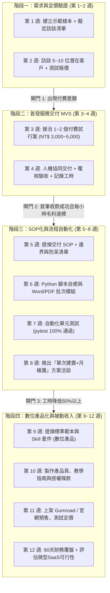

# 06｜90 天 AI 變現行動看板

> **主軸策略**：以「公共工程/營造文件合規檢查服務」作為先鋒驗證，後續標準化為自動化工作流與數位產品。  
> **週期時間**：2026-11-01 至 2027-01-31（共 12 週）  
> **決策閘門原則**：每一階段結束時，檢視付費意願與每小時毛利；未達標則原地調整或轉向，嚴禁盲目推進。

---

## 總覽甘特時間軸（12 週四階段）

---

## 詳細週次里程碑與行動卡片

### 【階段一：需求與定價驗證】（第 1–2 週）
- **第 1 週：去識別化示範產物（Demo Artifact）製作**
  - [ ] 挑選一份 50 頁標準公共工程施工/監造計畫書樣本（去識別化、移除機敏資訊）。
  - [ ] 執行現行 AI 批次格式整理與條款合規比對，產出「批改標註版與差異總表」。
  - [ ] 設計 1 頁客製化「服務價值主張簡報/PDF 單頁」（展示能省下工務 80% 檢查時間）。
- **第 2 週：潛在客戶訪談與付費測試**
  - [ ] 列出 10 位營造廠主任技師、工務所長、顧問公司監造同仁清單。
  - [ ] 一對一私下展示 Demo，詢問：「如果一份 80 頁計畫書能在 2 小時內完成排版與合規標註，收費 NT$ 3,500，您是否有意願將下一案委託試行？」
  - [ ] 記錄反對意見（如：個資外洩擔憂、特定主管排版偏好）。
  - 🛑 **決策閘門 1**：若至少有 2 位表達明確試用意願，且至少 1 位承諾付費試行，則進入階段二；否則調整服務痛點。

---

### 【階段二：交付第一個真實付費服務】（第 3–4 週）
- **第 3 週：服務規格鎖定與合約簽訂**
  - [ ] 產出《服務驗收與保密協議手冊》（明確限定：僅排版與條款索引，工程實質品質仍由原技師確認）。
  - [ ] 簽訂第 1 個付費試行專案（收費 NT$ 3,000 ~ 5,000）。
- **第 4 週：人工＋AI 協同交付與詳細日誌記錄**
  - [ ] 執行交付：AI 預處理（耗時 30 分鐘）➔ 人工嚴格覆核（耗時 60 分鐘）。
  - [ ] 記錄真實工時、API 成本（如 OpenAI/Gemini 消耗約 NT$ 30）、修改次數。
  - [ ] 完成交付並請客戶簽核驗收單、給予真實文字回饋。
  - 🛑 **決策閘門 2**：每小時貢獻毛利需高於 NT$ 1,000（計算：[收入 4,000 - 成本 100] / 投入 2.5 小時 = NT$ 1,560/hr）。

---

### 【階段三：標準化與流程自動化】（第 5–8 週）
- **第 5 週：SOP 提煉與異常清單固化**
  - [ ] 將第 4 週的交付步驟沉澱為標準 SOP，條列常見 15 種格式錯誤與正則替換規則。
- **第 6 週：自動化腳本封裝**
  - [ ] 撰寫本機 Python 批次處理模組（利用 `docx` 與 `win32com` 批次修正樣式、自動產生法規勾稽表）。
- **第 7 週：強固測試與自癒驗收**
  - [ ] 撰寫 `test_workflow.py` 測試套件，涵蓋損壞 Word、缺頁、無效字元等 8 種邊界情境。
  - [ ] 達成 100% pytest 通過，確保無黑窗靜默穩定執行。
- **第 8 週：推出「建置＋月費」服務方案**
  - [ ] 向該客戶或同業提案：「部署專案工務所自動化小幫手（建置費 NT$ 25,000，每月技術維護費 NT$ 3,000）」。
  - 🛑 **決策閘門 3**：單次交付工時必須自 2.5 小時降至 45 分鐘以內，自動化成功率達 90% 以上。

---

### 【階段四：數位產品化與被動收入】（第 9–12 週）
- **第 9 週：提煉「採購法與公共工程 AI 工具包」**
  - [ ] 將驗證過之提示詞、Word 檢核巨集/腳本與法規知識庫封裝為可攜式數位產品。
- **第 10 週：撰寫操作說明與無風險體驗指南**
  - [ ] 撰寫完整的快速上手手冊、常見問題集（FAQ）、免責聲明與個人授權協議。
- **第 11 週：小規模上架銷售與行銷測試**
  - [ ] 建立定價：入門版 NT$ 790、專業版 NT$ 1,490。
  - [ ] 在專業臉書社團/個人 LinkedIn/LINE 群發布示範影片與免費 3 頁試用版，引流付費購買。
- **第 12 週：90 天財務全面覆盤與下一季決策**
  - [ ] 匯算 90 天總營收、總成本、投入工時與每小時淨毛利。
  - [ ] 若模式 B 與 C 累積用戶超過 20 位且有強烈雲端協作需求，再評估是否啟動模式 D（微型 SaaS）。
