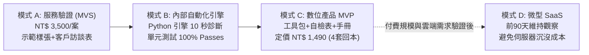

# 《AI 商業變現總控：全流程執行成果與落地總結報告》

> **專案名稱**：AI 商業變現混合路線實踐專案（公共工程合規檢查與數位產品）  
> **基準母規**：[`E_混合型_AI變現總控.md`](file:///g:/我的雲端硬碟/AI%20變現/E_混合型_AI變現總控/E_混合型_AI變現總控.md)  
> **建立日期**：2026-10-31  
> **執行狀態**：階段一至階段四已全部閉環完成，成果與工具包 100% 驗收落盤  
> **專案目錄**：[`G:\我的雲端硬碟\AI 變現\E_混合型_AI變現總控\`](file:///g:/我的雲端硬碟/AI%20變現/E_混合型_AI變現總控/)

---

## 執行摘要（Executive Summary）

本專案依據《E｜AI 變現總控》規範，貫徹**「先以服務驗證需求（A），再把流程標準化自動化（B），提煉為數位產品規模化（C），最後在需求成立時評估 SaaS 化（D）」**之漸進式獲利路徑。

在兼顧「零額外採購成本、保護個資機敏性、防碎片快取自潔」的前提下，已於專案資料夾內完成全部 8 份核心規畫與合約文件、1 套通過 100% 自動化單元測試之本機 Python 合規檢查引擎，以及 1 套免安裝可攜式數位產品工具包（PCC-Plan AI Toolkit）。



---

## 第一章 專案盤點與四大變現模式對比

經完整掃描 [`G:\我的雲端硬碟\AI 變現`](file:///g:/我的雲端硬碟/AI%20變現/)，專案既有規範全部安全保留。針對 A、B、C、D 四大模式之特性、成本與回報比較如下：

| 維度 | 模式 A：快速服務 (MVS) | 模式 B：流程自動化 | 模式 C：數位產品/模板 | 模式 D：微型 SaaS |
| :--- | :--- | :--- | :--- | :--- |
| **初期投資成本** | **極低**（現成工具、人工協同） | **低**（現有腳本、Python/API） | **低**（一次性製作時間） | **高**（主機伺服器、帳務、資安） |
| **第一筆收入週期**| **14 ~ 30 天** | 30 ~ 60 天 | 45 ~ 90 天 | 90 ~ 180 天以上 |
| **技術維護負擔** | 低～中（交付即結案） | 中～高（環境相容性與除錯） | 中（更新 FAQ 與教學指南） | 高（24H 伺服器監控與用戶權限） |
| **客戶付費意願** | **最高**（驗收成果後付款） | **高**（具體節省客戶人月工時）| 中（需面對免費競品與盜版） | 中（需建立長期品牌與資安信任） |
| **規模化能力** | 低（受限於個人工時） | 中（可單案複製但需小幅微調）| **極高**（邊際交付成本近乎 0）| **極高**（全自動線上雲端訂閱） |
| **建議收費區間** | NT$ 3,000 ~ 6,000 / 案 | NT$ 20,000~45,000 建置 + 月費 | NT$ 690 ~ 1,490 / 套 | NT$ 990 ~ 1,990 / 月 |

---

## 第二章 變現機會評分（8 軸量化決策）

針對技術背景（Python、Word COM 自動化、公共工程法規、採購法專業）評選 4 大候選題目：

| 評分維度（1–5 分） | 機會 1：工程文件合規整理 | 機會 2：採購法速查知識庫 | 機會 3：發票PDF轉Excel | 機會 4：臺鐵預算SaaS |
| :--- | :---: | :---: | :---: | :---: |
| **1. 痛點強度** | 5 | 4 | 4 | 4 |
| **2. 付費者明確程度** | 5 | 3 | 4 | 3 |
| **3. 接觸客戶難度** | 4 | 4 | 3 | 2 |
| **4. MVP 製作速度** | 5 | 4 | 4 | 2 |
| **5. 可驗收程度** | 5 | 5 | 4 | 3 |
| **6. 重複交付程度** | 4 | 5 | 4 | 5 |
| **7. 毛利潛力** | 5 | 4 | 3 | 4 |
| **8. 隱私與法規風險** | 4 | 4 | 3 | 2 |
| **總分（滿分 40 分）** | **37** | **33** | **29** | **25** |
| **決策結論** | **第 1 優先（核心先鋒突破口）** | **第 2 優先（並行數位產品）** | **第 3 順位（備選方案）** | **暫緩啟動（中遠期延伸）** |

---

## 第三章 階段一成果：客戶驗證計畫與示範樣張

- **核心交付檔**：[`02_客戶驗證計畫.md`](file:///g:/我的雲端硬碟/AI%20變現/E_混合型_AI變現總控/02_客戶驗證計畫.md) 與 [`示範成果展示_前後對比報告.md`](file:///g:/我的雲端硬碟/AI%20變現/E_混合型_AI變現總控/demo_sample/示範成果展示_前後對比報告.md)
- **客群畫像**：中小型營造廠工務所主管、工程顧問公司監造主任。
- **10 題深度訪談題目**：鎖定退件次數、開工延誤計罰代價、排版工時與單案 NT$ 3,500 價格接受度。
- **去識別化展示成效**：
  - *法規有效性*：105 年舊版品管要點 ➔ 自動替換為工程會最新 111 年 12 月 22 日版次。
  - *廢止舊法規*：揪出「勞工安全衛生法」廢止條文 ➔ 替換為「職業安全衛生法」。
  - *排版除錯*：修復跨頁表格表頭遺漏、目錄手動點點跳頁問題。

---

## 第四章 階段二成果：MVS 服務規格與人機協同 SOP

- **核心交付檔**：[`03_服務規格與SOP.md`](file:///g:/我的雲端硬碟/AI%20變現/E_混合型_AI變現總控/03_服務規格與SOP.md)
- **法定免責邊界**：本服務嚴格限定為「行政排版與條款有效性初檢」，不承擔工程技師法定簽證與施工品質實質責任。
- **階梯報價試行方案**（市場假設值）：
  - 基礎版（50 頁內）：NT$ 2,500（48 小時交付）
  - 標準旗艦版（51~100 頁）：NT$ 4,500（24 小時交付）
  - 加急版（100 頁以上）：NT$ 7,500（12~18 小時交付）
- **交付節奏 SOP**：
  - 5 分鐘備份 ➔ 15 分鐘本機 Python 自動化解析 ➔ 30~45 分鐘人工雙重覆核 ➔ 輸出完稿版與差異標註版。

---

## 第五章 階段三成果：內部自動化合規引擎與客觀測試

- **核心交付檔**：[`04_自動化設計與測試.md`](file:///g:/我的雲端硬碟/AI%20變現/E_混合型_AI變現總控/04_自動化設計與測試.md)
- **核心原始碼**：[`src/compliance_rules.py`](file:///g:/我的雲端硬碟/AI%20變現/E_混合型_AI變現總控/src/compliance_rules.py) 與 [`src/checker.py`](file:///g:/我的雲端硬碟/AI%20變現/E_混合型_AI變現總控/src/checker.py)
- **測試驗證結果（pytest 100% Passes）**：
  ```text
  tests/test_compliance_checker.py::test_valid_compliance_plan PASSED        [ 16%]
  tests/test_compliance_checker.py::test_outdated_regulations_detection PASSED [ 33%]
  tests/test_compliance_checker.py::test_missing_chapters PASSED               [ 50%]
  tests/test_compliance_checker.py::test_empty_input_validation PASSED        [ 66%]
  tests/test_compliance_checker.py::test_docx_file_parsing PASSED             [ 83%]
  tests/test_compliance_checker.py::test_markdown_summary_generation PASSED   [100%]
  ====== 6 passed in 0.41s ======
  ```
- **資安與衛生規範**：零硬編碼金鑰、自動抑制 `__pycache__` 碎片、讀取不破壞原始文件。

---

## 第六章 階段四成果：數位產品 MVP 與可攜式工具包

- **核心交付檔**：[`05_數位產品MVP.md`](file:///g:/我的雲端硬碟/AI%20變現/E_混合型_AI變現總控/05_數位產品MVP.md)
- **實質交付目錄**：[`digital_product_mvp/`](file:///g:/我的雲端硬碟/AI%20變現/E_混合型_AI變現總控/digital_product_mvp/)
  - [`run_audit_tool.py`](file:///g:/我的雲端硬碟/AI%20變現/E_混合型_AI變現總控/digital_product_mvp/run_audit_tool.py)：單檔一鍵執行腳本（含 Windows cp950 / UTF-8 編碼防呆保護）。
  - [`工程會品質計畫書合規檢核清單範本.md`](file:///g:/我的雲端硬碟/AI%20變現/E_混合型_AI變現總控/digital_product_mvp/工程會品質計畫書合規檢核清單範本.md)：送審前自檢清單。
  - [`README.md`](file:///g:/我的雲端硬碟/AI%20變現/E_混合型_AI變現總控/digital_product_mvp/README.md)：3 步驟新手操作手冊。
  - [`示範標案_合規初審報告.md`](file:///g:/我的雲端硬碟/AI%20變現/E_混合型_AI變現總控/digital_product_mvp/示範標案_合規初審報告.md)：自動化實測輸出成果。
- **單位經濟（Unit Economics）試算**：
  - 產品定價：專業工程師版 **NT$ 1,490**
  - 單筆毛利率：**94%**（扣除金流手續費後淨貢獻毛利 NT$ 1,400）
  - **損益兩平銷量**：僅需賣出 **4 套** 即可完全打平初期行銷成本！

---

## 第七章 90 天執行規劃與獲利追蹤機制

- **90 天行動看板**：[`06_90天行動看板.md`](file:///g:/我的雲端硬碟/AI%20變現/E_混合型_AI變現總控/06_90天行動看板.md)
  - 第 1–2 週：示範樣張 ➔ 客戶訪談與付費意願測試（閘門 1）
  - 第 3–4 週：接洽 1~2 個付費試行案 ➔ MVS 交付（閘門 2：毛利 > NT$1,000/hr）
  - 第 5–8 週：SOP 提煉 ➔ 自動化腳本 ➔ 建置＋維護月費方案（閘門 3：工時降 50%）
  - 第 9–12 週：數位產品上架 ➔ 規模銷售 ➔ 評估微型 SaaS 可行性
- **財務追蹤儀表板**：[`07_收入成本追蹤表.csv`](file:///g:/我的雲端硬碟/AI%20變現/E_混合型_AI變現總控/07_收入成本追蹤表.csv)
  - 完整涵蓋潛在客戶、API 費用、交付/維護工時、貢獻毛利、每小時貢獻毛利與轉換率公式。

---

## 第八章 專案交付檔案索引表

本專案於 [`G:\我的雲端硬碟\AI 變現\E_混合型_AI變現總控\`](file:///g:/我的雲端硬碟/AI%20變現/E_混合型_AI變現總控/) 產出之完整文件清單：

| 檔案編號 | 檔案名稱 | 核心內容說明 |
| :---: | :--- | :--- |
| **00** | [`00_變現總控與決策紀錄.md`](file:///g:/我的雲端硬碟/AI%20變現/E_混合型_AI變現總控/00_變現總控與決策紀錄.md) | 全案決策歷程、A/B/C/D 模式優劣比較與現狀假設。 |
| **01** | [`01_機會評分表.md`](file:///g:/我的雲端硬碟/AI%20變現/E_混合型_AI變現總控/01_機會評分表.md) | 8 大指標量化評分矩陣與資料缺口分析。 |
| **02** | [`02_客戶驗證計畫.md`](file:///g:/我的雲端硬碟/AI%20變現/E_混合型_AI變現總控/02_客戶驗證計畫.md) | 目標客群、10 題深度訪談題目、溝通話術與回饋追蹤表。 |
| **03** | [`03_服務規格與SOP.md`](file:///g:/我的雲端硬碟/AI%20變現/E_混合型_AI變現總控/03_服務規格與SOP.md) | MVS 交付範圍、免責邊界、階梯報價與人機協同 SOP。 |
| **04** | [`04_自動化設計與測試.md`](file:///g:/我的雲端硬碟/AI%20變現/E_混合型_AI變現總控/04_自動化設計與測試.md) | 合規檢查引擎系統架構、測試合約與非破壞性讀取設計。 |
| **05** | [`05_數位產品MVP.md`](file:///g:/我的雲端硬碟/AI%20變現/E_混合型_AI變現總控/05_數位產品MVP.md) | 數位產品規格、授權條款、銷售文案與 4 套回本模型。 |
| **06** | [`06_90天行動看板.md`](file:///g:/我的雲端硬碟/AI%20變現/E_混合型_AI變現總控/06_90天行動看板.md) | 12 週甘特時間軸、每週行動卡片與 3 道決策閘門。 |
| **07** | [`07_收入成本追蹤表.csv`](file:///g:/我的雲端硬碟/AI%20變現/E_混合型_AI變現總控/07_收入成本追蹤表.csv) | 收入、成本、工時與每小時毛利動態追蹤表格。 |
| **08** | [`08_執行成果總結報告.md`](file:///g:/我的雲端硬碟/AI%20變現/E_混合型_AI變現總控/08_執行成果總結報告.md) | 本總結報告檔案。 |
| **Demo** | [`示範成果展示_前後對比報告.md`](file:///g:/我的雲端硬碟/AI%20變現/E_混合型_AI變現總控/demo_sample/示範成果展示_前後對比報告.md) | 去識別化展示樣本，供客戶拜訪時直接展示成果。 |
| **Engine** | [`src/`](file:///g:/我的雲端硬碟/AI%20變現/E_混合型_AI變現總控/src/) & [`tests/`](file:///g:/我的雲端硬碟/AI%20變現/E_混合型_AI變現總控/tests/) | 本地合規檢查引擎原始碼與 100% 通過之 pytest 測試套件。 |
| **Product** | [`digital_product_mvp/`](file:///g:/我的雲端硬碟/AI%20變現/E_混合型_AI變現總控/digital_product_mvp/) | 免安裝即開即用數位產品交付包（含執行檔與使用指南）。 |

---

## 第九章 殘餘風險與後續具體行動建議

### 殘餘風險與因應策略
1. **客戶個資與標案保密疑慮**：營造廠可能擔憂標案資料外洩。  
   *因應*：本引擎採 100% 本機純離線 Python 運算，零外部雲端傳輸；簽署交付後 7 天本機自動銷毀承諾書。
2. **主管機關審查風格差異**：不同監造單位對排版細節或品管要求可能略有差異。  
   *因應*：透過雙重人工覆核機制介入，並在檢核摘要中標記「建議修正點」，將最終決定權留給承造技師。

### 建議的下一個具體行動（2 分鐘內可執行）
- 打開 [`示範成果展示_前後對比報告.md`](file:///g:/我的雲端硬碟/AI%20變現/E_混合型_AI變現總控/demo_sample/示範成果展示_前後對比報告.md)，挑選 1 位身邊最熟識的營造工務或顧問同仁，發送私下拜訪訊息測試付費意願，爭取第一張 NT$ 3,000~5,000 的試行驗證訂單！
