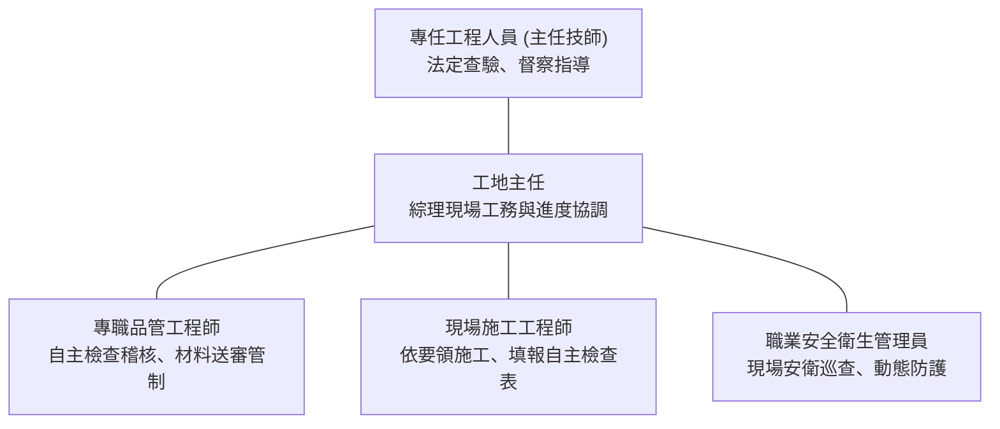

# 【公共工程示範標案】整體品質管制計畫書（正式完稿版）

> **法令依據**：行政院公共工程委員會 111 年 12 月 22 日最新修正「公共工程施工品質管理作業要點」  
> **適用採購**：公告金額以上公共工程整體施工計畫與品質管制  
> **編製單位**：甲級聯合營造工程股份有限公司工務所  
> **審查簽證**：專任工程人員（主任技師）／專職品管工程師  
> **版次日期**：中華民國 115 年 10 月・第 A 版（送審核定版）

---

## 目錄（Table of Contents）

- **第一章 計畫編製說明與工程概述**
  - 1.1 編製依據
  - 1.2 工程概要與範圍
  - 1.3 計畫適用範圍與修訂程序
- **第二章 品質管理組織及職責**
  - 2.1 品質管理組織架構
  - 2.2 專任工程人員職責與到場查驗時機（111年最新修正要點）
  - 2.3 工地主任與品管人員工作重點
- **第三章 施工要領與作業程序**
  - 3.1 分項工程劃分與施工流程
  - 3.2 主要分項工程施工要領（鋼筋、模板、混凝土、基礎開挖）
- **第四章 品質管理標準**
  - 4.1 施工品質管理標準表
  - 4.2 施工公差控制基準
- **第五章 材料及施工檢驗程序**
  - 5.1 材料設備送審管制總表與程序
  - 5.2 檢驗停留點（Hold Point）管制措施
- **第六章 自主檢查與管制措施**
  - 6.1 三級品管自主檢查機制
  - 6.2 分項工程自主檢查表清單與標準範本（表 6-1 鋼筋工程）
- **第七章 不合格品之管制與矯正預防**
  - 7.1 不合格品之定義、分類與隔離程序
  - 7.2 缺失改善通知單與追蹤改善銷案流程
- **第八章 矯正與預防措施**
  - 8.1 矯正措施審查時機與成因分析
  - 8.2 定期品質檢討會議運作機制
- **第九章 文件紀錄管理系統與品質稽核**
  - 9.1 品質文件編號、保管與五年存檔規範
  - 9.2 內部品質稽核計畫與執行成果紀錄

---

## 第一章 計畫編製說明與工程概述

### 1.1 編製依據
本整體品質管制計畫書係依據行政院公共工程委員會民國 111 年 12 月 22 日最新修正之「公共工程施工品質管理作業要點」、勞動部現行「職業安全衛生法」及「營造安全衛生設施標準」、工程採購契約規範、施工圖說及相關工程技術工法規範編製。  
本計畫書旨在建立健全之施工品質保證與自主品質管制體系，落實品質三級品管制度中之第一級承造人自主品管作業，確保本工程施工品質符合設計契約要求，如期如質安全完工。

### 1.2 工程概要與範圍

| 工程項目 | 規格與說明內容 |
| :--- | :--- |
| **工程標案名稱** | 新北市某示範段公共工程公共基礎建設計畫 |
| **工程主管／主辦機關** | 行政院公共工程委員會 ／ 新北市政府工務局 |
| **監造技術顧問單位** | 台灣現代工程技術顧問股份有限公司 |
| **施工得標承造廠商** | 甲級聯合營造工程股份有限公司 |
| **契約工期與施工地點** | 開工日起 450 日曆天 ／ 新北市特定工區範圍 |
| **主要工程施工項目** | 深基礎開挖排樁擋土、地下鋼筋混凝土箱涵、橋梁墩柱耐震補強、周邊景觀道路排水工程 |
| **品質計畫適用級別** | 依工程會作業要點規定：屬公告金額以上未達巨額採購之標案，編製「整體品質管制計畫書」 |

### 1.3 計畫適用範圍與修訂程序
本計畫書適用於本工程契約範圍內所有分項工程之材料、機具、施工工法及相關品質檢驗管理。工程進行中若遭遇契約重大變更、工法調整或主管機關法規修正時，承造廠商應於變更確定後 14 日內完成修訂，並提送專任工程人員簽認後，報請監造單位審查及主辦機關核定後據以實施。

---

## 第二章 品質管理組織及職責

### 2.1 品質管理組織架構
工務所設立專責品質管理組織，由專任工程人員督導，工地主任綜理現場行政與進度，專職品管人員獨立行使品質稽核與監督權限，品管人員不受現場工期進度牽制，確保客觀品質原則。

### 2.2 專任工程人員職責與到場查驗時機（111 年最新修正規範）
依據工程會 111 年 12 月 22 日修正之「公共工程施工品質管理作業要點」第三點及營造業法第三十五條規定，專任工程人員（主任技師）應負責指導現場施工技術並親自執行關鍵查驗節點：

| 查驗階段 / 項目 | 專任工程人員法定職責與查驗重點 | 簽認文件與查核留存 |
| :--- | :--- | :--- |
| **基礎開挖完成階段** | 現場查驗擋土排樁垂直度、地下水位觀測、開挖面基底承載力及支撐安全設施。 | 專任工程人員督察督導紀錄表、開挖查驗紀錄 |
| **結構鋼筋綁紮完成** | 查驗柱梁接頭錨定長度、保護層厚度、搭接長度及開口補強鋼筋配置。 | 鋼筋自主查驗簽認表、現場查驗照片 |
| **混凝土澆置前查核** | 查驗模板支撐穩定度、脫模劑塗布、預埋管線固定及施工縫處理。 | 澆置查驗簽署單、監造抽查會簽單 |
| **重大施工工法變更** | 審核支撐結構計算書、臨時擋土施工圖說並出具技術評估意見。 | 技師簽證審查意見書、安全計算報告 |
| **施工查核與重大缺失改善**| 工程會查核小組督導時到場說明，指導結構性瑕疵之根本矯正對策。 | 查核小組紀錄簽名、缺失改善對策簽認表 |

### 2.3 工地主任與品管人員工作重點
1. **專職品管人員職責**：依工程會規定取得品管班合格證書，專職常駐工地，負責依核定計畫書執行施工品質稽核、審查材料檢驗合格報告、統計不合格品缺失改善情形，並按日填報品管自主檢查報表，落實材料送審追蹤管制。
2. **現場工程師與領班**：嚴格依施工要領及標準作業程序施工，於各檢驗停留點（Hold Point）前主動完成自主檢查。

---

## 第三章 施工要領與作業程序

### 3.1 分項工程劃分與施工流程
本標案依工種特性劃分為四大主要分項工程，各分項於開工前均須提送專門分項施工計畫書經監造審定：
1. **基礎與擋土工程**：排樁引孔、擋土安全監測、土方分層開挖、地下安全支撐。
2. **鋼筋工程**：進場材料檢驗、加工彎折、吊運存放、現場綁紮固定、保護層墊塊設置。
3. **模板工程**：放樣彈線、模板組立、支撐架設、繫件緊密螺栓鎖固、塗刷脫模劑。
4. **混凝土工程**：預拌廠評鑑、配比設計、澆置前查驗、泵送搗實、施工縫處理、濕治養護。

### 3.2 主要分項工程施工要領
- **鋼筋工程施工要領重點**：
  - 鋼筋表面應保持清潔，無浮銹、油脂、泥土或其他影響握裹力之有害雜質。
  - 鋼筋彎折一律以常溫機械彎折，嚴禁現場火烤加熱彎折。
  - 梁柱接頭箍筋第一道起步筋距柱邊不得大於 5 公分，135 度彎鉤平直長度須達 10d 且不小於 7.5 公分。
  - 樓板與梁柱外圍保護層厚度嚴格落實水泥砂漿墊塊或塑膠環形墊塊固定，每平方公尺不得少於 4 處。
- **混凝土工程施工要領重點**：
  - 混凝土自出機至現場澆置完成之時間，不得超過 90 分鐘。
  - 泵送自由傾落高度不得大於 1.5 公尺，避免骨材分離；澆置時插入式振動棒間距不大於 45 公分，垂直快速插入緩慢拔出，不得接觸鋼筋及模板震動。

---

## 第四章 品質管理標準

### 4.1 施工品質管理標準表

| 分項工程 | 管理項目 | 品質管理標準 | 檢查時機 | 檢查方法與工具 | 不合格處置 |
| :--- | :--- | :--- | :--- | :--- | :--- |
| **鋼筋工程** | 間距與保護層 | 梁柱公差在 ±1cm 內；板牆公差在 ±0.5cm 內 | 綁紮完成後澆置前 | 捲尺量測、游標卡尺 | 拆卸重新綁紮調整墊塊 |
| **鋼筋工程** | 搭接長度 | 拉力搭接依設計圖規定，不小於 40d ~ 60d | 加工及綁紮時 | 捲尺抽量各部位接頭 | 焊接補強或增加搭接長度 |
| **模板工程** | 垂直度平整度 | 垂直公差 3m 內不大於 3mm；平整度不大於 2mm | 模板組立加固後 | 水準儀、雷射經緯儀、水平尺 | 鬆開支撐調整螺桿重新調校 |
| **混凝土工程** | 坍度與氯離子 | 坍度 15±3.8cm；水溶性氯離子含量小於 0.15kg/m³ | 每車進場澆置前 | 坍度筒檢驗、硬化前氯離子儀 | 整車退回原預拌廠不准使用 |
| **混凝土工程** | 28天抗壓強度 | 取樣試體強度不低於設計強度 fc' (280 kgf/cm²) | 依規定天數養護試壓 | 萬能試驗機 (TAF認證實驗室) | 鑽心取樣試驗並評估結構安全 |

### 4.2 施工公差控制基準
所有主體結構尺寸偏差均符合工程會施工規範公差上限，模板垂直偏差超過 5mm 者嚴禁澆置混凝土，確保完工成型結構美觀安全。

---

## 第五章 材料及施工檢驗程序

### 5.1 材料設備送審管制總表與程序
所有材料設備於進場使用前 30 日曆天，承造商應備齊出廠證明、原廠檢驗合格報告、型錄規格書及樣品，填具材料送審單提請監造單位審查核定。材料進場時會同監造抽樣送驗，試驗合格後始得使用於主體工程。

| 材料名稱 | 規格標準 / 契約依據 | 進場抽驗頻率 | 檢驗項目與依據 | 檢驗機構 |
| :--- | :--- | :--- | :--- | :--- |
| **竹節鋼筋** | CNS 560 SD420W 耐震熱軋鋼筋 | 每批 50 公噸或每規格各取樣 1 組 | 抗拉強度、屈服強度、伸長率、彎曲試驗 | TAF 認證材料實驗室 |
| **預拌混凝土** | CNS 3090 / 280 kgf/cm² 及 350 kgf/cm² | 每 100 立方公尺或每日澆置取樣 1 組 (5個試體) | 坍度、氯離子含量、7天及28天抗壓強度 | 工地現場初檢 + TAF認證實驗室 |
| **無收縮水泥砂漿**| CNS 14936 早期高強非金屬型 | 每批進場 200 包取樣 1 組 | 流動度、膨脹率、3天及28天抗壓強度 | TAF 認證材料實驗室 |
| **自黏性防水毯** | CNS 10159 / 彈性改質瀝青厚 2.0mm | 每批進場每 1000 平方公尺取樣 1 組 | 拉伸強度、斷裂伸長率、低溫耐寒撓度 | TAF 認證材料實驗室 |

### 5.2 檢驗停留點（Hold Point）管制措施
本工程明訂關鍵檢驗停留點，承造廠商未經自主檢查合格並經監造單位現場查驗簽認合格前，**絕對不得擅自進行下一道工序**：
1. 基礎開挖達預定高程查驗。
2. 基礎底板及各樓層梁柱板鋼筋綁紮完成驗收。
3. 模板支撐組立完成及澆置前查驗。
4. 結構體防水層施作前基層查驗與試水試驗。
5. 隱蔽管線壓力試驗完成查驗。

---

## 第六章 自主檢查與管制措施

### 6.1 三級品管自主檢查機制
現場工程師於每日施工分項進行時，必須攜帶自主檢查表至現場逐項實測實量並勾稽記錄，檢查合格後簽名陳報專任品管人員。品管人員依核定之抽查比率（不得低於 30%）進行實體複查，複查無誤後始向監造單位提出查驗申請。

### 6.2 《鋼筋工程自主檢查表》（表 6-1 示範樣版）

| 檢查項目與步驟 | 契約品質標準及規範要求 | 現場實際檢查結果記錄 | 判定 (合格/不合格) |
| :--- | :--- | :--- | :---: |
| **1. 鋼筋進場規格與出廠標示** | 符合 CNS 560 規定，標示清楚無嚴重浮銹 | 規格符合標案圖說要求 | **合格** |
| **2. 鋼筋搭接長度與位置錯開** | 受拉搭接長度不小於 45d，相鄰搭接錯開 60cm 以上 | 搭接長度 75cm，位置依圖錯開 | **合格** |
| **3. 梁柱接頭核心區箍筋綁紮** | 柱箍筋維持閉合圍束，梁柱接頭內箍筋確實綁紮 | 接頭內配置 3 道閉合箍筋 | **合格** |
| **4. 開口角隅處斜向補強鋼筋** | 門窗開口 4 角各配置 2 支 #4 斜向 45 度補強筋 | 4 個角隅均配置 2 支 #4 補強筋 | **合格** |
| **5. 保護層墊塊配置數量與間距**| 每平方公尺不得少於 4 處，材質為高密度水泥塊 | 間距約 80cm，配置均勻牢固 | **合格** |
| **6. 綁紮鐵絲端頭處理** | 鐵絲端頭一律朝內彎折，嚴禁朝向模板外側外露 | 鐵絲端頭已向內側壓平 | **合格** |

---

## 第七章 不合格品之管制與矯正預防

### 7.1 不合格品之定義、分類與隔離程序
施工或材料檢驗結果未符合契約標準時，即判定為不合格品，依缺失程度分類管制：
1. **嚴重缺失**：影響結構安全、耐震能力或隱蔽部分之瑕疵（如混凝土試體強度不足、鋼筋保護層嚴重不足、基礎基底擾動等）。  
   *處置程序*：立即停工、設立警示黃線與告示牌隔離標示，並於 24 小時內提報專任工程人員審定矯正對策，報監造審定後依核定方案改善。
2. **一般缺失**：外觀平整度不足、小蜂窩麻面、保護層墊塊少數鬆脫等。  
   *處置程序*：限期於當日或 3 日內修復複查銷案。

### 7.2 缺失改善通知單與追蹤改善銷案流程
品管人員開立「缺失改善通知單」（附改善前彩色照片），送交現場工程師要求施工領班限期完成改善；改善完成後拍照存證，由品管人員會同專任工程人員實地複查，複查合格後始准銷案並報監造單位備查。

---

## 第八章 矯正與預防措施

### 8.1 矯正措施審查時機與成因分析
凡同一分項工程重複發生相同缺失 2 次以上，或經工程會查核小組列為丙等扣點項目者，應啟動矯正預防專案程序。  
品管組召集現場工程師與施工工班，使用「魚骨圖分析法」從人（人員素質）、機（機具功能）、料（材料品質）、法（作業要領程序）、環（天候環境）五大維度剖析真因，徹底消除造成缺失之根本原因，防止再發。

### 8.2 定期品質檢討會議運作機制
工務所每月定期召開「品質管制檢討會議」，由工地主任主持，專任工程人員及品管人員出席指導，檢討當月材料送審進度、自主檢查缺失統計分析、監造抽查意見辦理情形，並列管下月重要檢驗停留點。

---

## 第九章 文件紀錄管理系統與品質稽核

### 9.1 品質文件編號、保管與五年存檔規範
品質文件採用統一工程編號系統，所有自主檢查表、材料試驗報告、專任工程人員督導紀錄表、缺失改善追蹤表等，按章節分門別類建立檔案夾妥善保存於工務所防潮文件箱中。  
依工程會最新要點規定，所有品管與監造核定文件紀錄，承造廠商應自工程完工驗收合格之日起，**妥善保管備查至少五年**，以備日後審計部及工程施工查核單位調閱查核。

### 9.2 內部品質稽核計畫與執行成果紀錄
總公司品管組每季定期針對工務所執行 1 次內部品質稽核，稽核內容包含：自主檢查表填寫即時性、專任工程人員到場督察頻率、材料送審是否逾期未報、不合格品隔離標示情形。稽核報告列管追蹤至缺失改善完畢，確保工務所品質體系持續有效運作。
