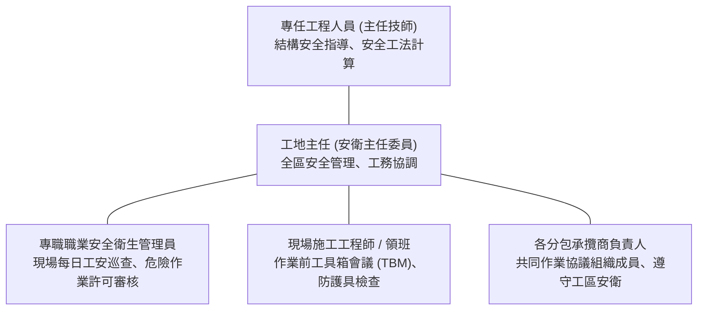

# 【公共工程示範標案】職業安全衛生管理計畫書（正式完稿版）

> **法令依據**：勞動部現行「職業安全衛生法」、「營造安全衛生設施標準」及工程會安衛要點  
> **適用採購**：公告金額以上公共工程整體施工安衛體系送審核定  
> **編製單位**：甲級聯合營造工程股份有限公司工務所  
> **審查簽證**：專任工程人員（主任技師）／專職職業安全衛生管理員  
> **版次日期**：中華民國 115 年 10 月・第 A 版（送審核定版）

---

## 目錄（Table of Contents）

- **第一章 計畫編製說明與法令依據**
  - 1.1 編製目的與宗旨
  - 1.2 引用最新法定標準清單
- **第二章 職業安全衛生管理組織與人員執掌**
  - 2.1 工務所職安管理組織架構
  - 2.2 專任工程人員與職安人員執掌
- **第三章 危害辨識、評估與風險控制計畫**
  - 3.1 營造四大重大災害預防重點（墜落、倒塌、感電、物體飛落）
- **第四章 施工安全衛生設施防護標準**
  - 4.1 核心安全防護設施規格基準（護欄90cm、防墜母索、漏電斷路器）
- **第五章 職業安全衛生自動檢查實施計畫**
  - 5.1 定期檢查、重點檢查與每日作業前檢點
- **第六章 安全衛生教育訓練與宣導計畫**
  - 6.1 入場前危害告知與工安教育（6小時受訓、每日工具箱會議 TBM）
- **第七章 緊急應變與重大職災通報處置計畫**
  - 7.1 災害通報流程與 2 小時法定通報限制
  - 7.2 緊急事故通報聯絡與責任醫院後送網絡
- **第八章 承攬商管理與共同作業協議組織運作**
  - 8.1 共同作業協議組織設置與會議召開（落實職安法第 27 條）

---

## 第一章 計畫編製說明與法令依據

### 1.1 編製目的與宗旨
為防止本工程施工期間發生職業災害，保障所有現場作業勞工之生命安全與身心健康，承造廠商依據國家職業安全衛生法規及工程契約規範編製本職業安全衛生管理計畫書。  
本計畫秉持「以人為本、全員工安、預防重於治療、零重大職災」之最高政策目標，落實各級管理責任與安全防護措施，確保工程於零事故安全環境下順利推動。

### 1.2 引用最新法定標準清單

| 法規名稱 | 發布機關與現行版次 | 本標案適用規範重點 |
| :--- | :--- | :--- |
| **職業安全衛生法** | 勞動部現行有效法規（舊稱勞安法已廢止） | 雇主預防危害義務、安全防護設施設置、職災通報責任。 |
| **職業安全衛生法施行細則** | 勞動部現行有效法規 | 工作場所負責人定義、自動檢查及承攬管理細部規定。 |
| **營造安全衛生設施標準** | 勞動部 112 年 12 月最新修正版 | 護欄高90cm以上、安全母索強度、開挖擋土支撐及防墜網。 |
| **職業安全衛生管理辦法** | 勞動部現行法規 | 常駐安全管理人員配置、職業安全衛生管理體系建立。 |
| **公共工程安全衛生管理作業要點** | 行政院公共工程委員會現行要點 | 專任工程人員查驗安全事項、機關安全抽查及安衛量化計價。 |

---

## 第二章 職業安全衛生管理組織與人員執掌

### 2.1 工務所職安管理組織架構
工務所設置專責職業安全衛生管理單位，由專任工程人員指導重大施工安全工法，工地主任兼任安衛主任委員，配置合格甲種職業安全衛生業務主管及專職安全衛生管理員，依法常駐現場督導施工安全，對危及勞工生命安全之危險作業具「停工制止權」。

### 2.2 專任工程人員與職安人員法定執掌

| 職務名稱 | 配置資格與證照要求 | 法定安全執掌與任務 |
| :--- | :--- | :--- |
| **專任工程人員** | 具土木技師執業執照 | 審查施工擋土排樁結構計算、施工架受力計算，指導安全施工程序。 |
| **工地主任** | 營造業工地主任執業執照 | 擔任安衛主任委員，綜理全區工安巡檢，督促改善安全防護缺失。 |
| **專職職安管理員** | 經勞動部結業合格領有證書 | 按日巡查工區各工作面、執行危險作業許可簽發、實施動態危害告知。 |
| **現場工程師與領班** | 現場分項施工負責人員 | 作業前執行工具箱會議（TBM）、檢查個人防護具穿戴、防墜設施就位。 |

---

## 第三章 危害辨識、評估與風險控制計畫

### 3.1 營造四大重大災害預防重點

| 災害類型 | 潛在作業情境 | 風險評估等級 | 工程控制與管理防護對策 |
| :--- | :--- | :---: | :--- |
| **墜落、滾落** | 開口部、樓梯邊緣、施工架高處組拆 | **極度高度 (重大風險)** | 高2m以上作業強制繫掛安全帶；開口部設90cm標準護欄及安全母索。 |
| **倒塌、崩塌** | 深開挖土方、擋土排樁、結構支撐架 | **極度高度 (重大風險)** | 嚴格依技師審核之支撐圖施工；每日觀測地下水位及傾度儀監測數據。 |
| **感電危害** | 臨時動力用電、電銲作業、抽水沉水泵 | **高度風險** | 分電盤全面裝設高感度高速型漏電斷路器；電線架高嚴禁浸泡水中。 |
| **物體飛落** | 吊車吊運鋼筋模板、高空結構體施工 | **中度風險** | 吊臂下方劃設警戒隔離區，吊鉤加裝防滑舌片；全員強制戴安全帽。 |

---

## 第四章 施工安全衛生設施防護標準

### 4.1 核心安全防護設施規格基準
依據營造安全衛生設施標準最新修正規範，本工區各項防護設施一律落實以下物理標準：
1. **標準安全護欄**：高度不得低於 90 公分，須具備上欄杆、中欄杆（45cm）及高度 10 公分以上之腳趾板，承受外力不得小於 75 公斤。
2. **高空防墜母索**：採用直徑 9mm 以上鋼索或聚酯纖維編織繩，每跨距錨定點不超過 10 公尺，單一錨定點抗拉強度須達 2,300 公斤以上。
3. **安全防護網**：水平安全網掛設於工作面下方不大於 3 公尺處，網體完好無破損，且每季進行衝擊試驗檢驗。
4. **臨時用電安全**：所有插座分路必須配置額定感度電流 30mA、動作時間 0.1 秒以內之高速型漏電斷路器。

---

## 第五章 職業安全衛生自動檢查實施計畫

### 5.1 定期檢查、重點檢查與每日作業前檢點

| 檢查層級 | 檢查對象與項目 | 檢查週期與頻率 | 執行人員與紀錄保存 |
| :--- | :--- | :--- | :--- |
| **作業前檢點** | 勞工安全防護具（安全帽/雙掛鉤安全帶）、漏電斷路器試跳 | 每日作業開始前 | 現場領班與作業勞工，填寫作業檢點卡。 |
| **定期自主檢查** | 移動式起重機吊鉤舌片、車輛系營建機械、深開挖支撐應力 | 每週一次 / 每月一次 | 職安人員與機具操作手，保存檢查表備查。 |
| **重點安全檢查** | 施工架繫牆桿與斜撐固定、開口部護欄穩固度、氣體鋼瓶防傾倒 | 每週二定期大巡查 | 工地主任會同職安人員與分包商代表。 |
| **雨後震後特檢** | 四級以上地震後或強降雨後，查驗開挖面邊坡、支撐受力及配電箱 | 地震或大雨停止後立即實施 | 專任工程人員及品管職安小組聯合查驗。 |

---

## 第六章 安全衛生教育訓練與宣導計畫

### 6.1 入場前危害告知與工安教育
所有進場勞工（包含承攬商及點工）於首次進場作業前，一律必須完成「新進勞工一般安全衛生教育訓練」至少 6 小時，並簽署危害告知單，未受訓者嚴禁發給工區識別證及進場施工。  
每日早晨 7:50 實施「工具箱會議（Toolbox Meeting, TBM）」，由現場工程師向作業工班宣導當日作業危害動線與防護重點，確認全員身心精神狀況良好（嚴禁酒後進場）。

---

## 第七章 緊急應變與重大職災通報處置計畫

### 7.1 災害通報流程與法定通報限制
依據職業安全衛生法第三十七條第二項規定，工區若不幸發生重大職業災害（包括罹災死亡、罹災人數達 3 人以上、或化學物外洩致 1 人以上住院者），雇主應於 **8 小時內（本計畫嚴格自律為 2 小時內）** 通報勞動部勞動檢查機構及主辦機關、監造單位。  
- 通報電話：勞動部職業安全衛生署北區職業安全衛生中心（02-8995-6666）、緊急救護專線 119。
- 後送責任醫院：衛生福利部台北醫院（急診專線：02-2276-5566，距工區車程約 12 分鐘）。

---

## 第八章 承攬商管理與共同作業協議組織運作

### 8.1 共同作業協議組織設置與會議召開
依據職業安全衛生法第二十七條規定，本工程事業單位與下包承攬人、再承攬人共同作業時，設置「施工安全衛生協議組織」，由工地主任擔任召集人，每月定期召開會議 1 次，每週召開工務協調檢討會。  
協議組織工作包括：安全衛生管理計畫之實施配合、勞工作業之連繫與調整、工作場所之巡視、相關承攬事業間之安全衛生教育指導及統一指揮協調，徹底落實現場原事業單位承攬統合管理責任。
