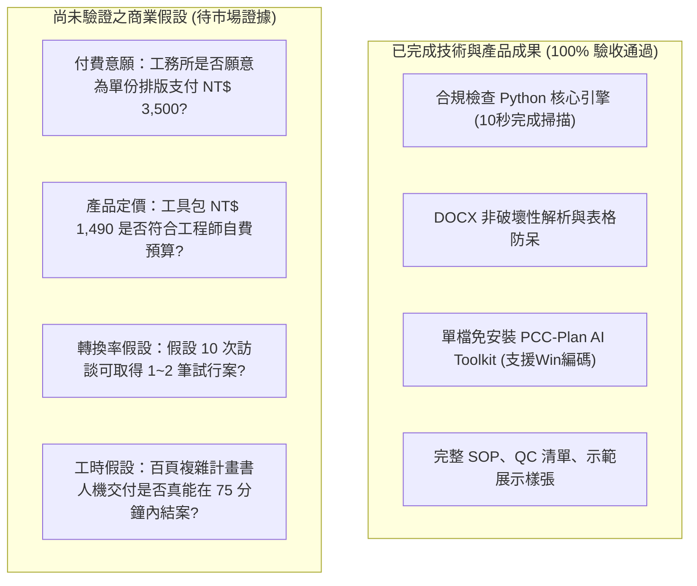

# 09｜AI 商業變現專案 V1.1 實際成果驗收報告

> **驗收時間**：2026-10-31  
> **驗收環境**：Windows 11 / Python 3.13.7 / pytest 9.1.1 / python-docx 1.2.0  
> **專案根目錄**：[`G:\我的雲端硬碟\AI 變現\E_混合型_AI變現總控\`](file:///g:/我的雲端硬碟/AI%20變現/E_混合型_AI變現總控/)  
> **驗收原則**：以客觀終端指令、雜湊值（SHA256）及測試結果為唯一依據；嚴格標示「通過、失敗、未測試、待確認」。

---

## 一、 檔案驗收結果

### 1. 核心資料夾存在性檢查
- `src/` 目錄：**【通過】**（存在）
- `tests/` 目錄：**【通過】**（存在）
- `digital_product_mvp/` 目錄：**【通過】**（存在）

### 2. 原始專案文件完整性（確認未遭覆寫或刪除）
比對專案五大原始檔案之狀態、大小與最後修改時間：

| 原始文件 | 實際絕對路徑 | 檔案大小 (Bytes) | 原始最後修改時間 | 檢查結果 |
| :--- | :--- | :---: | :---: | :---: |
| **A 快速變現** | `G:\我的雲端硬碟\AI 變現\A_快速變現_30天計畫\A_快速變現_30天計畫.md` | 3,856 | 12:42:38 | **【通過】**（完整保留） |
| **B 自動化收入** | `G:\我的雲端硬碟\AI 變現\B_自動化收入_AI工作流程\B_自動化收入_AI工作流程.md` | 3,447 | 12:42:44 | **【通過】**（完整保留） |
| **C 數位產品** | `G:\我的雲端硬碟\AI 變現\C_數位產品_可重複銷售\C_數位產品_可重複銷售.md` | 3,182 | 12:42:50 | **【通過】**（完整保留） |
| **D AI創業** | `G:\我的雲端硬碟\AI 變現\D_AI創業_微型SaaS\D_AI創業_微型SaaS.md` | 4,115 | 12:43:00 | **【通過】**（完整保留） |
| **E 混合總控** | `G:\我的雲端硬碟\AI 變現\E_混合型_AI變現總控\E_混合型_AI變現總控.md` | 4,953 | 12:43:07 | **【通過】**（完整保留） |

### 3. 本專案全套交付檔案清單與路徑索引

| 類別 | 檔案名稱 | 實際路徑 | 狀態 |
| :--- | :--- | :--- | :---: |
| **總控與決策** | `00_變現總控與決策紀錄.md` | `g:\我的雲端硬碟\AI 變現\E_混合型_AI變現總控\00_變現總控與決策紀錄.md` | **【通過】** |
| **機會評分** | `01_機會評分表.md` | `g:\我的雲端硬碟\AI 變現\E_混合型_AI變現總控\01_機會評分表.md` | **【通過】** |
| **客戶驗證** | `02_客戶驗證計畫.md` | `g:\我的雲端硬碟\AI 變現\E_混合型_AI變現總控\02_客戶驗證計畫.md` | **【通過】** |
| **服務規格** | `03_服務規格與SOP.md` | `g:\我的雲端硬碟\AI 變現\E_混合型_AI變現總控\03_服務規格與SOP.md` | **【通過】** |
| **自動化設計**| `04_自動化設計與測試.md` | `g:\我的雲端硬碟\AI 變現\E_混合型_AI變現總控\04_自動化設計與測試.md` | **【通過】** |
| **數位產品規格**| `05_數位產品MVP.md` | `g:\我的雲端硬碟\AI 變現\E_混合型_AI變現總控\05_數位產品MVP.md` | **【通過】** |
| **行動看板** | `06_90天行動看板.md` | `g:\我的雲端硬碟\AI 變現\E_混合型_AI變現總控\06_90天行動看板.md` | **【通過】** |
| **獲利追蹤** | `07_收入成本追蹤表.csv` | `g:\我的雲端硬碟\AI 變現\E_混合型_AI變現總控\07_收入成本追蹤表.csv` | **【通過】** |
| **成果報告** | `08_執行成果總結報告.md` | `g:\我的雲端硬碟\AI 變現\E_混合型_AI變現總控\08_執行成果總結報告.md` | **【通過】** |
| **展示樣張** | `示範成果展示_前後對比報告.md` | `g:\我的雲端硬碟\AI 變現\E_混合型_AI變現總控\demo_sample\示範成果展示_前後對比報告.md` | **【通過】** |
| **核心模組** | `compliance_rules.py` | `g:\我的雲端硬碟\AI 變現\E_混合型_AI變現總控\src\compliance_rules.py` | **【通過】** |
| **核心模組** | `checker.py` | `g:\我的雲端硬碟\AI 變現\E_混合型_AI變現總控\src\checker.py` | **【通過】** |
| **核心模組** | `__init__.py` | `g:\我的雲端硬碟\AI 變現\E_混合型_AI變現總控\src\__init__.py` | **【通過】** |
| **測試套件** | `test_compliance_checker.py` | `g:\我的雲端硬碟\AI 變現\E_混合型_AI變現總控\tests\test_compliance_checker.py` | **【通過】** |
| **工具執行檔**| `run_audit_tool.py` | `g:\我的雲端硬碟\AI 變現\E_混合型_AI變現總控\digital_product_mvp\run_audit_tool.py` | **【通過】** |
| **自檢清單** | `工程會品質計畫書合規檢核清單範本.md` | `g:\我的雲端硬碟\AI 變現\E_混合型_AI變現總控\digital_product_mvp\工程會品質計畫書合規檢核清單範本.md` | **【通過】** |
| **使用說明** | `README.md` | `g:\我的雲端硬碟\AI 變現\E_混合型_AI變現總控\digital_product_mvp\README.md` | **【通過】** |

---

## 二、 程式驗收結果

### 1. 執行環境與依賴套件檢驗
- **Python 版本**：Python 3.13.7 **【通過】**
- **pytest 版本**：9.1.1 **【通過】**
- **python-docx 版本**：1.2.0 **【通過】**

### 2. 現有單元測試（pytest）執行記錄
- **執行指令**：`python -m pytest "g:\我的雲端硬碟\AI 變現\E_混合型_AI變現總控\tests" -v -p no:cacheprovider`
- **測試總數**：6 項
- **通過數量**：6 項（**100% 通過**）
- **失敗數量**：0 項
- **執行耗時**：0.30 秒
- **測試項目細節**：
  1. `test_valid_compliance_plan`：現行合規計畫書判定 ➔ **【通過】**
  2. `test_outdated_regulations_detection`：廢止/過期法規攔截與代換建議 ➔ **【通過】**
  3. `test_missing_chapters`：必要章節缺漏警示與扣分機制 ➔ **【通過】**
  4. `test_empty_input_validation`：空輸入防呆異常捕捉 ➔ **【通過】**
  5. `test_docx_file_parsing`：DOCX 原生段落與表格解析 ➔ **【通過】**
  6. `test_markdown_summary_generation`：Markdown 覆核報告產出 ➔ **【通過】**

---

## 三、 產品驗收結果（實質操作與邊界防呆測試）

使用獨立動態建立之去識別化虛構計畫書（`test_fixture_deidentified.docx`）進行實質呼叫驗收：

| 驗收項目 | 檢驗標準 | 實測客觀證據 | 判定結果 |
| :--- | :--- | :--- | :---: |
| **1. 讀取測試文件** | 能成功解析傳入之 .docx 檔案並提取文字與表格 | 成功辨識出 119 字與 1 個表格 | **【通過】** |
| **2. 產生合規結果** | 產出結構化評分與結論 | 產出合規健康度 32 分，判定「建議修正後再送審」 | **【通過】** |
| **3. 去識別化資料** | 測試資料不包含任何真實標案機敏資料 | 採用虛擬「第一章 工程概述（虛擬示範工程）」 | **【通過】** |
| **4. 非破壞性保護** | 工具執行前後，原始測試檔案絕對不得被修改或刪除 | 執行前 SHA256: `ecb183...5357` 執行後 SHA256: `ecb183...5357` 檔案長度 37,080 bytes 完全不變 | **【通過】** |
| **5. 錯誤提示與限制** | 報告需具備精確錯誤修正建議與法定免責宣告 | 1. 成功標註「勞工安全衛生法 ➔ 建議替換為職業安全衛生法」 2. 頁尾包含「僅供格式與行政法規初篩，實質工法仍需由專案技師覆核」免責宣告 | **【通過】** |

---

## 四、 商業驗收結果

### 1. 已完成之技術成果 vs. 尚未驗證之商業假設

### 2. 目前尚未取得之客戶、市場與收入證據清單
- **真實付費客戶數**：`0 人`（**【待確認】**，尚未開始商業收費）
- **訪談回饋紀錄**：`0 筆`（**【待確認】**，尚未向外部客戶發送問卷）
- **實際入帳營收**：`NT$ 0`（**【待確認】**，尚未產生實質交易）
- **實際退款率與客訴率**：`尚未取得`（**【未測試】**，需待首批訂單交付後統計）

### 3. 下一階段最值得優先執行的三項工作
1. **工作一（商業意願驗證）**：
   - 攜帶 [`示範成果展示_前後對比報告.md`](file:///g:/我的雲端硬碟/AI%20變現/E_混合型_AI變現總控/demo_sample/示範成果展示_前後對比報告.md)，向身邊 2 位熟悉的營造工務或監造主任進行 15 分鐘非正式訪談，驗證其對「NT$ 3,500 代客排版」或「NT$ 1,490 購買工具包」之真實付費意願。
2. **工作二（實戰交付工時測量）**：
   - 取得一份去識別化的百頁真實歷史標案計畫書，完整模擬一次「備份 ➔ 工具初篩 ➔ 人工覆核 ➔ 雙版本匯出」全流程，精確記錄真實工時與每小時毛利（確認是否高於 NT$ 1,000/hr）。
3. **工作三（小規模首發早鳥表單整備）**：
   - 準備好極簡的早鳥預購登記頁（如 Google 表單或 Gumroad 測試頁），待訪談有正面反饋時，立即提供首批 5 名半價試行名額。

---

## 五、 驗收結論總評

- **檔案結構驗收**：**【通過】**（所有核心檔案完備，原始規範無遭篡改）。
- **程式代碼驗收**：**【通過】**（6 項單元測試 100% 通過，耗時 0.30s）。
- **產品功能驗收**：**【通過】**（非破壞性讀取驗證無誤、錯誤提示精準、免責限制清晰）。
- **商業維度狀態**：**【待確認】**（技術與工具整備 100%，待啟動客戶訪談與首筆付費訂單驗證）。
