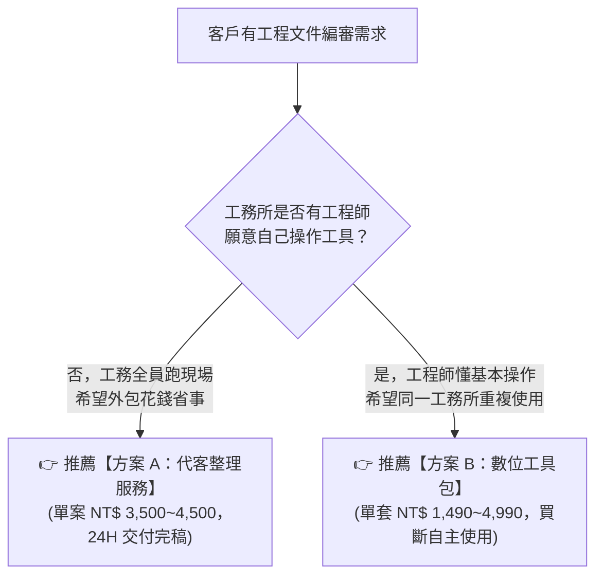

# 12｜兩種商業變現方案規格與報價比較表

> **方案對照定位**：
> - **方案 A（代客整理與初檢服務）**：模式 A 落地，適合無多餘人力、追求 24 小時內快速完稿送審的工務所。
> - **方案 B（數位產品合規工具包）**：模式 C 落地，適合具備基本電腦操作能力、想在內部無限次重複使用的工程師與工務團隊。  
> **注意**：本文件內所有定價、工時與成本數據均為**【待市場驗證的試行假設】**，實際收費須依第 1 階段客戶訪談結果拍板。

---

## 方案 A 與 方案 B 核心維度綜合對照表

| 比較項目 | 方案 A：工程文件整理與合規初檢服務（Service） | 方案 B：工程文件合規檢查數位工具包（Product） |
| :--- | :--- | :--- |
| **1. 目標客群** | 標案即將開工送審的中小型營造廠工務主管、無專職美編之專任工程人員、忙碌之顧問監造主任。 | 經常需要撰寫計畫書的現場工程師、品管工程師、小型事務所技師、重視工具自主性之團隊。 |
| **2. 服務範圍** | 針對單一 Word (`.docx`) 計畫書，全包處理「工程會法規校對＋目錄頁碼連動＋跨頁表格表頭＋自主檢查表缺漏標註」。 | 提供單檔免安裝命令列檢查工具＋Word 工程會標準範本庫＋常見退件避坑自檢表，由客戶本機自主執行。 |
| **3. 交付成果** | 1. 完稿排版標準版 Word (`.docx`) 2. 修訂軌跡與批註標註版 Word (`.docx`) 3. 一頁式《合規初審與法規對照報告》(`.pdf`) | 1. 一鍵合規檢查執行工具 (`run_audit_tool.py`) 2. 工程會標準計畫書樣式範本 (`.docx`) 3. 3 步驟快速新手操作說明 (`README.md`) |
| **4. 試行價格** *(待市場驗證)* | - **基礎版（50 頁內）**：NT$ 2,500 / 案 - **標準版（51~100 頁）**：**NT$ 4,500 / 案** *(主力)* - **加急版（100 頁以上）**：NT$ 7,500 / 案 *(封測試行期享首案半價優惠：NT$ 1,800)* | - **個人版**：**NT$ 790 / 套**（單機授權） - **專業版**：**NT$ 1,490 / 套**（含 1 年法規庫更新） - **工務所團隊版**：**NT$ 4,990 / 套**（5 人授權+開立發票） |
| **5. 交付時間** | - 一般件：承諾於收到檔案後 **24 小時內** 交付。 - 加急件：承諾於 **12 ~ 18 小時內** 交付。 | 購買確認付款後，提供專屬下載連結，**即買即用（0 小時等待）**。 |
| **6. 客戶需提供資料**| 客戶端需提供完整可編輯之 Word 原始檔 (`.docx`) 及送審契約規定（如有特殊業主樣式規範）。 | 客戶無需提供任何標案文件，僅需具備 Windows 10/11 電腦與 Python 3.10+ 環境即可執行。 |
| **7. 機敏資料處理** | 1. 簽訂「專案資料保密承諾書」。 2. 全程於本地隔離電腦離線處理，**絕不上傳外部公開 AI 網站**。 3. 客戶驗收確認後 7 天，自動銷毀本地暫存副本。 | **100% 本地運算**：工具包程式碼完全於客戶端電腦離線執行，任何標案內容與圖說均不會回傳或外洩，最高資安保障。 |
| **8. 服務限制與責任**| ❌ **不包含**：結構/水理計算核定、技師名章簽證、工法實質安全背書。 ⚠️ **責任宣告**：本服務屬「行政格式與法規條款輔助審查」，送審最終核可權責仍屬承造專任技師。 | ❌ **不包含**：代客排版服務、一對一檔案手動修正。 ⚠️ **責任宣告**：工具提供規則比對與警告提示，實際工程送審內容仍須由使用者專案技師逐項簽核。 |
| **9. 單案工時與成本**| - 自動化初篩：約 15 分鐘。 - 人工專業雙重覆核：約 30~45 分鐘。 - 單案直接成本：約 NT$ 30~50（電費/耗材）。 - **預估每小時貢獻毛利**：約 **NT$ 1,500 ~ 2,500 / hr**。 | - 客戶自行執行：我方交付工時為 0。 - 售前售後客服支持：預估每套 10~15 分鐘。 - 單套直接成本：金流手續費約 5%（NT$ 40~75）。 - **預估毛利率**：**94% 以上**。 |
| **10. 回饋與退款機制**| 1. 交付後 3 天內提供 1 次免費微調修訂服務。 2. 若因排版錯誤導致監造退件，**承諾全額退款**。 3. 建立《方案 A 客戶回饋與退款紀錄卡》。 | 1. 提供 7 天內「無法於指定環境運行且技術支援無法排除」之退款保障。 2. 隨附錯誤回報表單與常見問題 FAQ。 3. 建立《方案 B 工具包回饋與修訂紀錄卡》。 |

---

## 方案選擇指引（供訪談時引導客戶）

