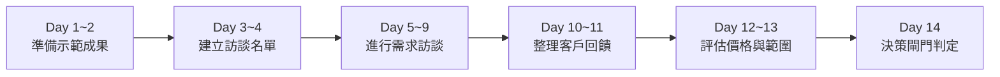

# 14｜首批試行服務 14 天需求與付費意願驗證執行計畫

> **執行目標**：透過 14 天結構化微型行動，在不花費任何廣告費與軟體採購的前提下，訪談 5~10 位公共工程領域同仁，確認真實工作痛點，並以「去識別化示範成果」爭取至少 1~2 筆付費試行意願（或工具包預購）。  
> **核心原則**：**先驗證付費意願，再投入實質交付；未經使用者明確指示，絕不主動對外聯絡、發布或收款。**

---

## 總覽時間軸（14 天六階段行動架構）

---

## 每日詳細行動卡片（Day 1 ～ Day 14）

### 【第一階段：準備示範成果】（Day 1 ～ Day 2）
- **Day 1：檢查示範樣張與印出準備**
  - [ ] **具體行動**：檢視專案目錄下之 [`示範成果展示_前後對比報告.md`](file:///g:/我的雲端硬碟/AI%20變現/E_混合型_AI變現總控/demo_sample/示範成果展示_前後對比報告.md)，確認廢止法規修正（勞安法 ➔ 職安法）與目錄自動對齊效果。
  - [ ] **工時預估**：30 分鐘。
  - [ ] **產物檢查**：確保樣張內 100% 無真實工程標案名稱、無特定承包商與技師個資。
- **Day 2：問卷工具與訪談紀錄表就位**
  - [ ] **具體行動**：將 [`10_客戶訪談問卷.md`](file:///g:/我的雲端硬碟/AI%20變現/E_混合型_AI變現總控/output/10_客戶訪談問卷.md) 匯出為可列印紙本或平板閱讀格式，熟悉 10 題深度提問節奏。
  - [ ] **工時預估**：20 分鐘。
  - [ ] **防呆檢查**：確認提問著重在「過去真實發生的退件與熬夜工時」，不向受訪者推銷產品。

---

### 【第二階段：建立訪談名單】（Day 3 ～ Day 4）
- **Day 3：盤點 10 位同業名單（私下口袋名單）**
  - [ ] **具體行動**：列出 10 位過往認識的營造廠工務主任、工程顧問監造主任、技師事務所朋友名單（姓名、公司、職稱、熟識程度）。
  - [ ] **工時預估**：45 分鐘。
  - [ ] **產物檢查**：填入內部名冊（僅本機記錄，絕不上傳網路）。
- **Day 4：擬定非正式拜訪邀約私訊**
  - [ ] **具體行動**：依據問卷背景，草擬一對一邀請訊息（例如：「陳所長您好，最近在研究公共工程計畫書常見退件問題，想跟您請教 15 分鐘現場經驗...」）。
  - [ ] **工時預估**：30 分鐘。
  - [ ] **安全限制**：未經使用者手動點擊送出前，AI 絕對不代為發送任何訊息。

---

### 【第三階段：進行一對一需求訪談】（Day 5 ～ Day 9）
- **Day 5：執行第 1~2 位受訪者訪談**
  - [ ] **具體行動**：拜訪最熟識的 2 位同仁，依序進行 10 題訪談，記錄每月文件量與退件原因。
  - [ ] **工時預估**：每日約 60 分鐘。
  - [ ] **紀錄落盤**：訪談結束後 30 分鐘內將客觀回答謄入 [`11_客戶訪談紀錄表.csv`](file:///g:/我的雲端硬碟/AI%20變現/E_混合型_AI變現總控/output/11_客戶訪談紀錄表.csv)。
- **Day 6：執行第 3~4 位受訪者訪談**
  - [ ] **具體行動**：訪談工程顧問公司監造主任，深入探討審查時最容易挑出的法規過期條款與排版地雷。
  - [ ] **工時預估**：60 分鐘。
- **Day 7：展示成果對比樣張並測試價格敏感度**
  - [ ] **具體行動**：對已完成痛點提問之受訪者，拿出《示範成果展示樣張》，詢問：「若能達成此效果，您認為單案 NT$ 3,500 或工具包 NT$ 1,490 是否符合預算？」
  - [ ] **工時預估**：40 分鐘。
- **Day 8：執行第 5~6 位受訪者訪談**
  - [ ] **具體行動**：拜訪中小型營造廠現場工程師，詢問其個人自費購買工具之意願（方案 B 接受度）。
  - [ ] **工時預估**：60 分鐘。
- **Day 9：訪談漏網追蹤與補充紀錄**
  - [ ] **具體行動**：整理未即時記錄之細節，檢查是否有至少 5 位有效受訪者紀錄。
  - [ ] **工時預估**：30 分鐘。

---

### 【第四階段：整理客戶回饋與分類】（Day 10 ～ Day 11）
- **Day 10：痛點頻率矩陣統計**
  - [ ] **具體行動**：統計受訪者最常被退件的 Top 3 痛點（如：法規版本過期佔幾成？跨頁表格跑版佔幾成？）。
  - [ ] **工時預估**：45 分鐘。
- **Day 11：更新需求驗證儀表板**
  - [ ] **具體行動**：將實際接觸數、訪談數、願意試用數客觀填入 [`13_客戶需求驗證儀表板.csv`](file:///g:/我的雲端硬碟/AI%20變現/E_混合型_AI變現總控/output/13_客戶需求驗證儀表板.csv)。
  - [ ] **工時預估**：20 分鐘。
  - [ ] **數據檢查**：確認無虛構數字，全為真實受訪反饋。

---

### 【第五階段：評估價格與服務範圍】（Day 12 ～ Day 13）
- **Day 12：方案 A 與 方案 B 偏好度裁決**
  - [ ] **具體行動**：比對客戶多數偏好「代客排版服務（花錢省事）」還是「數位工具包（自己操作）」。
  - [ ] **工時預估**：30 分鐘。
- **Day 13：定價區間微調**
  - [ ] **具體行動**：若受訪者普遍反映 NT$ 4,500 偏高，調整首批試行定價為 NT$ 2,500~3,000；若偏好軟體工具，微調工具包為入門版 NT$ 790。
  - [ ] **工時預估**：30 分鐘。

---

### 【第六階段：決策閘門判定與下一步】（Day 14）
- **Day 14：執行決策閘門（Decision Gate）綜合審查**
  - [ ] **具體行動**：依據客觀證據判定以下三條路徑之一：
    - 🟢 **路徑一（通過）**：有至少 1~2 位確認願意以 NT$ 2,500 以上付費委託試行案 ➔ 啟動真實試行案交付。
    - 🟡 **路徑二（調整 Pivot）**：客戶拒絕服務外包但高度想要工具包 ➔ 轉向集中推展模式 C（數位產品預購）。
    - 🔴 **路徑三（終止或轉向）**：受訪者均表示皆有免費實習生處理、無任何退件壓力與付費意願 ➔ 轉向下一個候選機會（機會 2：採購法題庫知識庫）。
  - [ ] **工時預估**：30 分鐘。
