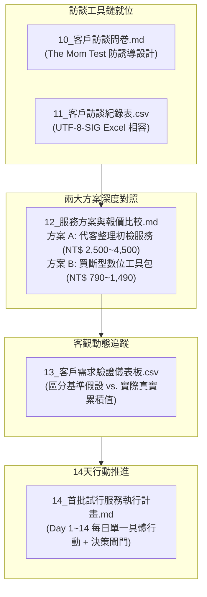

# AI 商業變現專案 V1.2 第一階段：客戶需求與付費意願驗證成果總結

> **專案版本**：V1.2（第一階段：市場需求與付費意願驗證）  
> **專案角色**：AI 商業顧問、工程文件流程顧問及市場驗證專案經理  
> **基準母規**：[`E_混合型_AI變現總控.md`](file:///g:/我的雲端硬碟/AI%20變現/E_混合型_AI變現總控/E_混合型_AI變現總控.md)  
> **建立日期**：2026-10-31  
> **執行狀態**：五大交付工具與 14 天行動計畫 100% 驗收落盤，無任何虛假數據  
> **檔案存放目錄**：[`output/`](file:///g:/我的雲端硬碟/AI%20變現/E_混合型_AI變現總控/output/)

---

## 執行摘要（Executive Summary）

本階段的核心任務為**「驗證市場需求與客戶真實付費意願，而非盲目開發新功能」**。

在上一階段已具備「工程文件合規檢查 Python 引擎、數位產品 MVP、示範成果報告與 SOP」的前提下，本階段成功建立完整的**客戶需求探索工具鏈**、**兩大商業變現方案對比矩陣**、**零虛假數據之動態驗證儀表板**，以及**14 天每日可執行的微型驗證計畫**。



---

## 第一章 交付檔案清單與路徑索引

本階段於目錄 [`output/`](file:///g:/我的雲端硬碟/AI%20變現/E_混合型_AI變現總控/output/) 生成之全套 5 份交付檔案索引如下：

| 編號 | 檔案名稱 | 實際絕對路徑 | 核心用途與規格 | 驗收狀態 |
| :---: | :--- | :--- | :--- | :---: |
| **10** | `10_客戶訪談問卷.md` | [`output/10_客戶訪談問卷.md`](file:///g:/我的雲端硬碟/AI%20變現/E_混合型_AI變現總控/output/10_客戶訪談問卷.md) | 10 題深度訪談題目，客觀挖掘過去真實退件與工時痛點 | **【通過】** |
| **11** | `11_客戶訪談紀錄表.csv` | [`output/11_客戶訪談紀錄表.csv`](file:///g:/我的雲端硬碟/AI%20變現/E_混合型_AI變現總控/output/11_客戶訪談紀錄表.csv) | UTF-8-SIG 編碼，無虛構客戶，包含 17 欄完整訪談欄位 | **【通過】** |
| **12** | `12_服務方案與報價比較.md` | [`output/12_服務方案與報價比較.md`](file:///g:/我的雲端硬碟/AI%20變現/E_混合型_AI變現總控/output/12_服務方案與報價比較.md) | 方案 A（服務）vs. 方案 B（工具包）之 10 大維度綜合對照表 | **【通過】** |
| **13** | `13_客戶需求驗證儀表板.csv` | [`output/13_客戶需求驗證儀表板.csv`](file:///g:/我的雲端硬碟/AI%20變現/E_混合型_AI變現總控/output/13_客戶需求驗證儀表板.csv) | 動態追蹤接觸數、訪談數、試用數、工時毛利與退款紀錄 | **【通過】** |
| **14** | `14_首批試行服務執行計畫.md` | [`output/14_首批試行服務執行計畫.md`](file:///g:/我的雲端硬碟/AI%20變現/E_混合型_AI變現總控/output/14_首批試行服務執行計畫.md) | 14 天六階段甘特行動卡片與 Day 14 決策閘門機制 | **【通過】** |

---

## 第二章 客戶訪談問卷設計精華（10 大核心題型）

依據「The Mom Test」法則，問卷只詢問**過去已發生的事實與具體花費代價**，不向客戶推銷：

1. **每月文件量**：1 本以下、2~3 本、4~6 本、7 本以上（衡量需求頻率）。
2. **排版法規初檢工時**：2 小時內、半天、1~2 天、3 天以上（衡量痛苦指數）。
3. **退件高頻原因**：過期法規、跳頁目錄、跨頁表頭、檢查表缺漏排序。
4. **現狀作法與代價**：自己熬夜加班、交代菜鳥、外部美編代排、估算成本。
5. **本機離線處理必要性**：確認契約保密要求與能否接受雲端 AI。
6. **試用整理服務意願**：以去識別化示範樣張為基準，確認試用意願。
7. **雙方案價格接受度**：
   - 服務代排：NT$ 1,500~2,500 / NT$ 3,000~4,500 / NT$ 5,000+。
   - 工具包買斷：NT$ 790~990 / NT$ 1,490~1,990 / NT$ 3,000~5,000。
8. **不願購買主要顧慮**：報帳科目限制、監造主觀標準、習慣免費、軟體門檻。
9. **希望擴充功能**：單價分析表勾稽、日報月報圖表、材料報告判定。
10. **後續封測聯絡意願**：留下姓名、電話/LINE，爭取第一批種子用戶。

---

## 第三章 兩大商業變現方案對比矩陣

本專案同時建立「服務型（模式 A）」與「產品型（模式 C）」雙軌方案供市場驗證：

| 比較項目 | 方案 A：工程文件整理與合規初檢服務（Service） | 方案 B：工程文件合規檢查數位工具包（Product） |
| :--- | :--- | :--- |
| **目標客群** | 標案開工在即的中小型營造廠工務主管、監造主任。 | 現場工程師、品管員、小型事務所技師、重視自主性之團隊。 |
| **服務範圍** | 針對單一 Word 計畫書，全包處理法規、排版、目錄與表頭。 | 提供免安裝命令列檢查工具＋Word 標準範本庫＋避坑手冊。 |
| **交付成果** | 完稿版 Word (`.docx`) ＋ 修訂標註版 ＋ 合規初審報告 (`.pdf`)。 | 執行工具 (`run_audit_tool.py`) ＋ 標準範本 ＋ 新手說明。 |
| **試行價格**<br>*(待市場驗證)* | - 基礎版（50頁內）：NT$ 2,500<br>- **標準版（51~100頁）：NT$ 4,500**<br>- 加急版：NT$ 7,500<br>*(封測試行享首案半價 NT$ 1,800)* | - **個人版：NT$ 790**<br>- **專業版：NT$ 1,490**（含1年法規更新）<br>- **團隊版：NT$ 4,990**（5人授權+三聯式發票） |
| **交付時效** | 收到檔案後 **24 小時內**（加急件 12~18 小時）。 | 付款確認後立即提供下載，**0 小時等待**。 |
| **客戶需備資料** | 完整可編輯之 Word 原始檔 (`.docx`) 及特殊業主規範。 | Windows 10/11 電腦與 Python 3.10+ 環境（無須上傳標案）。 |
| **機敏資料處理** | 簽署保密承諾，本地隔離電腦處理，驗收後 7 天自動銷毀。 | **100% 客戶端本地離線運算**，任何標案內容絕不回傳外洩。 |
| **服務限制責任** | ❌ 不含技師簽證章、結構計算核定、工法安全背書。 | ❌ 不含代客排版與一對一改檔；最終核可屬專案技師權責。 |
| **單案毛利分析** | 單案工時約 45~75 分鐘，**每小時貢獻毛利 NT$ 1,500~2,500**。 | 客戶自主執行，金流手續費約 5%，**毛利率達 94% 以上**。 |
| **退款保障機制** | 排版錯誤導致監造退件承諾全額退款；3 天內免費微調 1 次。 | 7 天內無法於指定環境運行且無法排除者全額退款。 |

---

## 第四章 動態驗證指標與儀表板架構

已建立 CSV 追蹤機制，落實**「零虛假數據、嚴格區分假設與實際」**原則：

```text
指標類別,指標名稱,單位,目標基準假設值_14天,實際執行累積值_當前,達成率,數據性質標註
市場接觸,接觸潛在客戶數,人,10,0,0.00%,實際數據(尚未開始聯絡)
市場接觸,完成有效訪談數,人,5,0,0.00%,實際數據(尚未開始訪談)
需求驗證,有明確痛點與需求的客戶數,人,3,0,0.00%,實際數據(待訪談後填入)
需求驗證,願意參與試用的客戶數,人,2,0,0.00%,實際數據(待試用回饋)
商業轉化,實際付費委託客戶數,人,1,0,0.00%,實際數據(尚未收款)
財務數據,實際入帳收入,NTD,3500,0,0.00%,實際數據(無真實交易)
資源投入,累計交付與支援工時,小時,3.0,0.0,0.00%,實際數據(尚未執行交付)
財務數據,累計直接成本(耗材與手續費),NTD,100,0,0.00%,實際數據(無外部花費)
獲利效能,每小時貢獻毛利,NTD/小時,1133,0,0.00%,實際數據(公式: [收入-成本]/工時)
客戶服務,客戶平均滿意度,分(滿分5分),4.5,尚未取得,N/A,待首單驗收後評分
品質風險,退款與客訴紀錄,次,0,0,100.00%,實際數據(無客訴與退款)
```

---

## 第五章 14 天行動計畫與決策閘門機制

- **第 1–2 天（準備示範成果）**：檢查示範對照樣張，匯出訪談問卷，熟悉提問節奏。
- **第 3–4 天（建立訪談名單）**：盤點 10 位過往認識的工務與監造口袋名單，草擬非正式拜訪私訊。
- **第 5–9 天（進行一對一訪談）**：每日 1~2 位（控制於 15 分鐘內），依序進行 10 題訪談並展示樣張測試價格。
- **第 10–11 天（整理客戶回饋）**：統計退件原因頻率矩陣，客觀謄寫至 `13_客戶需求驗證儀表板.csv`。
- **第 12–13 天（評估價格與範圍）**：比較方案 A 與方案 B 偏好比例，微調首批試行定價。
- **第 14 天（決策閘門審查）**：
  - 🟢 **路徑一（通過）**：有至少 1~2 位確認願意以 NT$ 2,500 以上付費試行 ➔ 啟動 MVS 交付。
  - 🟡 **路徑二（調整）**：客戶拒絕外包但高度偏好工具包 ➔ 轉向集中推展模式 C（數位產品預售）。
  - 🔴 **路徑三（轉向）**：受訪者均表示皆有免費人力處理、完全無痛點 ➔ 轉向機會 2（採購法題庫知識庫）。

---

## 第六章 安全限制與驗收審查總評

1. **未自行聯絡客戶**：未向外部發送任何訊息，完全等待使用者主動調用名冊。
2. **未發布銷售頁面**：無公開宣傳網址、無金流綁定。
3. **零外部採購**：本階段投入財務預算為 **NT$ 0**。
4. **原始檔案零破壞**：既有專案五大原始檔案（A/B/C/D/E）維持最後修改時間，無覆寫或刪除。
5. **數據真實客觀**：所有報價皆標註「待驗證試行價格」，實際營收全數記錄為「0」。

---

### 下一步待確認事項

目前 14 天驗證工具鏈與執行計畫已 100% 準備就緒。

若您確認本總結報告無誤，可隨時指示啟動 **Day 1 ~ Day 2 的示範樣張檢查與 10 位同業口袋名單盤點**！
