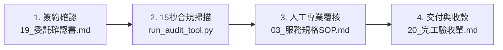

# 23｜AI 商業變現專案：全景導航地圖與快速取用手冊

> **專案代號**：PCC-Plan AI Monetization Project  
> **根目錄路徑**：[`G:\我的雲端硬碟\AI 變現\E_混合型_AI變現總控\`](file:///g:/我的雲端硬碟/AI%20變現/E_混合型_AI變現總控/)  
> **使用目的**：將全專案 20+ 份文件、核心代碼與即用工具包，依**「四大實戰情境」**分類索引，讓您在手機或電腦上一鍵直達所需物料。

---

## 實戰情境一：對客溝通與市場訪談（出門前／私訊必備）

當您準備與潛在客戶、營造廠所長或監造主任聯絡時，請直接使用以下檔案：

| 用途 | 檔案名稱 | 一鍵連結 |
| :--- | :--- | :--- |
| **現場出示展示單** | A4 一頁紙示範對照單（大字體、去識別化前後對照） | [`16_客戶展示專用_A4一頁紙示範對照單.md`](file:///g:/我的雲端硬碟/AI%20變現/E_混合型_AI變現總控/output/16_客戶展示專用_A4一頁紙示範對照單.md) |
| **私訊複製貼上** | 10 位同業口袋名單與邀約話術庫（3 種情境話術） | [`17_訪談名單建立與邀約話術庫.md`](file:///g:/我的雲端硬碟/AI%20變現/E_混合型_AI變現總控/output/17_訪談名單建立與邀約話術庫.md) |
| **臨場對話防呆** | 訪談實戰模擬演練與情境應變指南（三場真實沙盤） | [`22_訪談實戰模擬演練與情境應變指南.md`](file:///g:/我的雲端硬碟/AI%20變現/E_混合型_AI變現總控/output/22_訪談實戰模擬演練與情境應變指南.md) |
| **出發前自檢** | 訪談前置準備查核表（The Mom Test 心態守則） | [`18_訪談執行前置準備查核表.md`](file:///g:/我的雲端硬碟/AI%20變現/E_混合型_AI變現總控/output/18_訪談執行前置準備查核表.md) |
| **正式訪談問卷** | 10 題深度痛點與付費意願問卷 | [`10_客戶訪談問卷.md`](file:///g:/我的雲端硬碟/AI%20變現/E_混合型_AI變現總控/output/10_客戶訪談問卷.md) |
| **謄寫訪談紀錄** | 客戶訪談紀錄表（UTF-8-SIG Excel 相容 CSV） | [`11_客戶訪談紀錄表.csv`](file:///g:/我的雲端硬碟/AI%20變現/E_混合型_AI變現總控/output/11_客戶訪談紀錄表.csv) |

---

## 實戰情境二：客戶同意委託！首單極速交付流程（24 小時內）

當客戶看完樣張決定給您試行訂單（半價 NT$ 1,800）時，請依此 SOP 操作：

| 步驟 | 必備檔案與工具 | 說明 |
| :---: | :--- | :--- |
| **Step 1** | [`19_首筆試行服務保密與委託確認書.md`](file:///g:/我的雲端硬碟/AI%20變現/E_混合型_AI變現總控/output/19_首筆試行服務保密與委託確認書.md) | 與客戶簽署/確認，約定 24H 交付、滿意後付款與 100% 離線保密條款。 |
| **Step 2** | [`digital_product_mvp/run_audit_tool.py`](file:///g:/我的雲端硬碟/AI%20變現/E_混合型_AI變現總控/digital_product_mvp/run_audit_tool.py) | 執行指令 `python run_audit_tool.py "客戶檔案.docx"`，15 秒產出初審報告。 |
| **Step 3** | [`03_服務規格與SOP.md`](file:///g:/我的雲端硬碟/AI%20變現/E_混合型_AI變現總控/03_服務規格與SOP.md) ＋ [`21_實戰交付全流程演練與工時毛利測量紀錄.md`](file:///g:/我的雲端硬碟/AI%20變現/E_混合型_AI變現總控/output/21_實戰交付全流程演練與工時毛利測量紀錄.md) | 參照 SOP 執行 35 分鐘人工專業覆核（更新目錄、表頭重複、代換法規）。 |
| **Step 4** | [`20_試行專案完工驗收與客戶評價回饋單.md`](file:///g:/我的雲端硬碟/AI%20變現/E_混合型_AI變現總控/output/20_試行專案完工驗收與客戶評價回饋單.md) | 隨附交付檔案讓客戶簽認點收、收集 5 星好評與推薦語，並開立請款資訊。 |

---

## 實戰情境三：客戶想自己買軟體？數位產品工具包（模式 C 規模化）

當客戶偏好自行操作工具或工務所多人共用時：

| 組件 | 檔案路徑 | 說明 |
| :--- | :--- | :--- |
| **方案與定價比較** | [`12_服務方案與報價比較.md`](file:///g:/我的雲端硬碟/AI%20變現/E_混合型_AI變現總控/output/12_服務方案與報價比較.md) | 方案 A（服務）vs. 方案 B（工具包 NT$ 790/1,490）詳細對照。 |
| **數位產品規格書** | [`05_數位產品MVP.md`](file:///g:/我的雲端硬碟/AI%20變現/E_混合型_AI變現總控/05_數位產品MVP.md) | 完整產品規格、銷售文案草稿與 4 套回本之單位經濟模型。 |
| **免安裝即用工具包** | [`digital_product_mvp/`](file:///g:/我的雲端硬碟/AI%20變現/E_混合型_AI變現總控/digital_product_mvp/) | 包含 `run_audit_tool.py`、`README.md` 及工程會標準自檢表範本。 |

---

## 實戰情境四：專案總控、財務與 90 天行動管理

| 項目 | 檔案名稱 | 說明 |
| :--- | :--- | :--- |
| **決策紀錄歷史** | [`00_變現總控與決策紀錄.md`](file:///g:/我的雲端硬碟/AI%20變現/E_混合型_AI變現總控/00_變現總控與決策紀錄.md) | 記錄 V1.0 至 V1.6 各階段之演進里程碑與決策閘門狀態。 |
| **機會評分表** | [`01_機會評分表.md`](file:///g:/我的雲端硬碟/AI%20變現/E_混合型_AI變現總控/01_機會評分表.md) | 8 大指標量化評分（公共工程合規檢查 37/40 分）。 |
| **14 天行動計畫** | [`14_首批試行服務執行計畫.md`](file:///g:/我的雲端硬碟/AI%20變現/E_混合型_AI變現總控/output/14_首批試行服務執行計畫.md) | 每日拆解行動卡片與 Day 14 決策閘門標準。 |
| **90 天行動看板** | [`06_90天行動看板.md`](file:///g:/我的雲端硬碟/AI%20變現/E_混合型_AI變現總控/06_90天行動看板.md) | 12 週甘特時間軸與四大階段目標。 |
| **動態需求儀表板** | [`13_客戶需求驗證儀表板.csv`](file:///g:/我的雲端硬碟/AI%20變現/E_混合型_AI變現總控/output/13_客戶需求驗證儀表板.csv) | 動態追蹤接觸數、訪談數、毛利與客訴（Excel 相容）。 |
| **全期財務追蹤表** | [`07_收入成本追蹤表.csv`](file:///g:/我的雲端硬碟/AI%20變現/E_混合型_AI變現總控/07_收入成本追蹤表.csv) | 每週營收、工時與每小時淨毛利公式模型。 |
| **核心後台原始碼** | [`src/`](file:///g:/我的雲端硬碟/AI%20變現/E_混合型_AI變現總控/src/) ＆ [`tests/`](file:///g:/我的雲端硬碟/AI%20變現/E_混合型_AI變現總控/tests/) | 100% 通過之 pytest 單元測試核心模組。 |
| **階段總結報告** | [`08_執行成果總結報告.md`](file:///g:/我的雲端硬碟/AI%20變現/E_混合型_AI變現總控/08_執行成果總結報告.md) ＆ [`15_V1.2_第一階段成果報告.md`](file:///g:/我的雲端硬碟/AI%20變現/E_混合型_AI變現總控/output/15_V1.2_第一階段成果報告_客戶需求與付費意願驗證.md) | 完整里程碑交付總覽與驗證架構手冊。 |
