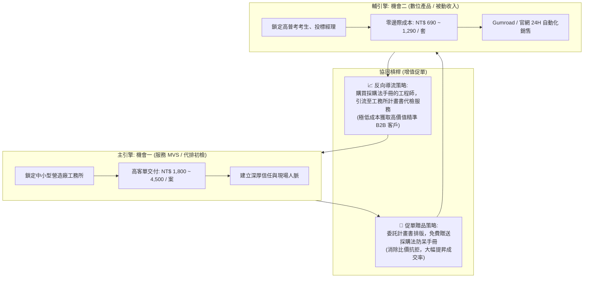

# 25｜雙軌雙引擎獲利推進策略：服務 MVS ＋ 數位產品規模化

> **核心架構**：主引擎【機會一：公共工程文件合規整理服務（模式 A）】 ＋ 輔引擎【機會二：採購法申論與合規手冊（模式 C）】。  
> **協同效應**：**「用高單價服務攻佔標案現金流，用零邊際成本數位產品擴大被動收入與品牌壁壘！」**

---

## 一、 雙引擎獲利飛輪（Flywheel Architecture）

---

## 二、 雙引擎時間分配與精力防呆原則（80 / 20 法則）

為避免「多線作戰、發散失焦」的創業陷阱，嚴格訂定每週工時配置：

- **80% 時間與精力（專注於機會一）**：
  - 嚴格推進 [`14_首批試行服務執行計畫.md`](file:///g:/我的雲端硬碟/AI%20變現/E_混合型_AI變現總控/output/14_首批試行服務執行計畫.md)，專注拜訪營造工務與監造主管，以取得第一張真實訂單為第一要務。
- **20% 時間與精力（兼顧機會二）**：
  - 每週利用 2 小時整理 5~10 題核心採購法經典申論擬答，預先備妥高價值贈品與數位產品內容庫。

---

## 三、 客戶終身價值（LTV）提升與客單價倍增模型

| 客戶接觸情境 | 傳統單一模式 | 雙軌協同模式（1+1 > 2） | 效益提升 |
| :--- | :--- | :--- | :---: |
| **情境 A：營造廠工務所長嫌 NT$ 3,500 貴** | 陷入降價談判，損害每小時毛利。 | 「所長，這期送審算您優惠價，我加贈一套價值 NT$ 1,290 的《採購法投標防呆指南》，讓貴所投標同仁案頭備用！」 | **不降價成交，價值感倍增** |
| **情境 B：獨立工程師自費購買 NT$ 790 工具包** | 單筆交易結束，無後續營收。 | 工程師日後標案遇到趕工危機，主動向所長推薦升級「方案 A 全包代客服務（NT$ 4,500）」。 | **個人用戶自然升級 B2B 訂單** |
| **情境 C：採購法考生購買 NT$ 1,290 申論手冊** | 純考生被動收入。 | 考生考取公務員或進入顧問公司後，成為機關採購與監造主任，成為未來長期客戶。 | **佈局長期業界關鍵決策人脈** |

---

## 四、 90 天雙引擎財務目標修訂模擬（標註初期模型假設）

在雙引擎並行推進下，原 90 天預估目標可更穩健地達成：

| 收入來源 | 保守情境 (假設) | 基準情境 (預估) | 樂觀情境 (預估) |
| :--- | :---: | :---: | :---: |
| **機會一：工程文件整理服務** | 8 案 × NT$ 2,500 = NT$ 20,000 | 18 案 × NT$ 3,500 = NT$ 63,000 | 30 案 × NT$ 4,000 = NT$ 120,000 |
| **機會一：工作流建置月維護 (轉模式 B)**| 0 家 (未簽約) | 1 家建置 + 2個月維護 = NT$ 30,000 | 2 家建置 + 維護 = NT$ 60,000 |
| **機會二：採購法數位手冊 (模式 C)** | 10 套 × NT$ 890 = NT$ 8,900 | 35 套 × NT$ 990 = NT$ 34,650 | 70 套 × NT$ 1,190 = NT$ 83,300 |
| **90 天全期預估總營收** | **NT$ 28,900** | **NT$ 127,650** | **NT$ 263,300** |
| **預估直接成本 (手續費/耗材)** | NT$ 800 | NT$ 3,500 | NT$ 7,500 |
| **全期預估貢獻毛利** | **NT$ 28,100** | **NT$ 124,150** | **NT$ 255,800** |
