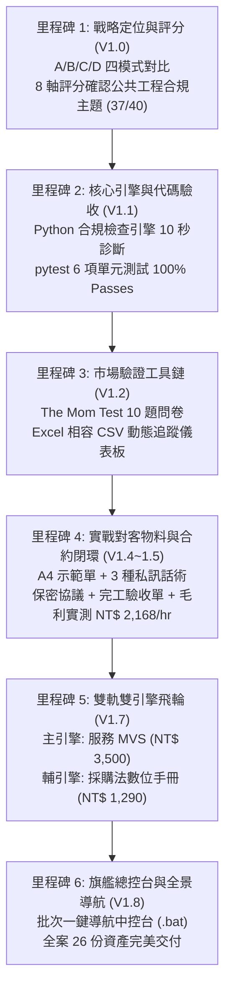

# 26｜AI 商業變現專案：終極里程碑交付手冊（V1.8 旗艦版）

> **專案名稱**：AI 商業變現混合路線實踐專案（公共工程合規檢查與採購法數位資產）  
> **專案版本**：V1.8 旗艦版（實戰就緒）  
> **基準母規**：[`E_混合型_AI變現總控.md`](file:///g:/我的雲端硬碟/AI%20變現/E_混合型_AI變現總控/E_混合型_AI變現總控.md)  
> **專案目錄**：[`G:\我的雲端硬碟\AI 變現\E_混合型_AI變現總控\`](file:///g:/我的雲端硬碟/AI%20變現/E_混合型_AI變現總控/)  
> **建立日期**：2026-10-31  

---

## 專案核心成果里程碑回顧

本專案歷經六個重要演進階段，全數落實「低成本、先驗證、零破壞、高毛利」原則：

---

## 全套 26 份資產完整數位清單索引

| 序號 | 檔案名稱 | 實際路徑 | 核心用途與規格 | 狀態 |
| :---: | :--- | :--- | :--- | :---: |
| **00** | `00_變現總控與決策紀錄.md` | [`00_變現總控與決策紀錄.md`](file:///g:/我的雲端硬碟/AI%20變現/E_混合型_AI變現總控/00_變現總控與決策紀錄.md) | V1.0 至 V1.8 全案演進歷程與決策閘門紀錄。 | **【完成】** |
| **01** | `01_機會評分表.md` | [`01_機會評分表.md`](file:///g:/我的雲端硬碟/AI%20變現/E_混合型_AI變現總控/01_機會評分表.md) | 8 大指標量化評分（公共工程合規檢查 37/40 分）。 | **【完成】** |
| **02** | `02_客戶驗證計畫.md` | [`02_客戶驗證計畫.md`](file:///g:/我的雲端硬碟/AI%20變現/E_混合型_AI變現總控/02_客戶驗證計畫.md) | 14 天訪談規劃、客群畫像與溝通範本。 | **【完成】** |
| **03** | `03_服務規格與SOP.md` | [`03_服務規格與SOP.md`](file:///g:/我的雲端硬碟/AI%20變現/E_混合型_AI變現總控/03_服務規格與SOP.md) | MVS 交付範圍、免責邊界與人機協同 SOP。 | **【完成】** |
| **04** | `04_自動化設計與測試.md` | [`04_自動化設計與測試.md`](file:///g:/我的雲端硬碟/AI%20變現/E_混合型_AI變現總控/04_自動化設計與測試.md) | 合規檢查引擎資料流、正則特徵庫與測試合約。 | **【完成】** |
| **05** | `05_數位產品MVP.md` | [`05_數位產品MVP.md`](file:///g:/我的雲端硬碟/AI%20變現/E_混合型_AI變現總控/05_數位產品MVP.md) | 工具包規格、銷售頁文案草稿與 4 套回本模型。 | **【完成】** |
| **06** | `06_90天行動看板.md` | [`06_90天行動看板.md`](file:///g:/我的雲端硬碟/AI%20變現/E_混合型_AI變現總控/06_90天行動看板.md) | 12 週甘特時間軸、每週行動卡片與決策閘門。 | **【完成】** |
| **07** | `07_收入成本追蹤表.csv` | [`07_收入成本追蹤表.csv`](file:///g:/我的雲端硬碟/AI%20變現/E_混合型_AI變現總控/07_收入成本追蹤表.csv) | 收入、成本、工時與每小時淨毛利動態儀表板。 | **【完成】** |
| **08** | `08_執行成果總結報告.md` | [`08_執行成果總結報告.md`](file:///g:/我的雲端硬碟/AI%20變現/E_混合型_AI變現總控/08_執行成果總結報告.md) | 前四階段實施總結報告（含測試證明）。 | **【完成】** |
| **09** | `output/09_專案實際驗收報告.md` | [`output/09_專案實際驗收報告.md`](file:///g:/我的雲端硬碟/AI%20變現/E_混合型_AI變現總控/output/09_專案實際驗收報告.md) | V1.1 客觀成果驗收報告（SHA256 非破壞性驗證）。 | **【完成】** |
| **10** | `output/10_客戶訪談問卷.md` | [`output/10_客戶訪談問卷.md`](file:///g:/我的雲端硬碟/AI%20變現/E_混合型_AI變現總控/output/10_客戶訪談問卷.md) | The Mom Test 10 題深度痛點與付費意願問卷。 | **【完成】** |
| **11** | `output/11_客戶訪談紀錄表.csv` | [`output/11_客戶訪談紀錄表.csv`](file:///g:/我的雲端硬碟/AI%20變現/E_混合型_AI變現總控/output/11_客戶訪談紀錄表.csv) | UTF-8-SIG 編碼，Excel 雙擊不亂碼之訪談紀錄表。 | **【完成】** |
| **12** | `output/12_服務方案與報價比較.md` | [`output/12_服務方案與報價比較.md`](file:///g:/我的雲端硬碟/AI%20變現/E_混合型_AI變現總控/output/12_服務方案與報價比較.md) | 方案 A（服務）vs. 方案 B（工具包）10 維度對比。 | **【完成】** |
| **13** | `output/13_客戶需求驗證儀表板.csv` | [`output/13_客戶需求驗證儀表板.csv`](file:///g:/我的雲端硬碟/AI%20變現/E_混合型_AI變現總控/output/13_客戶需求驗證儀表板.csv) | 動態追蹤接觸數、訪談數、毛利與客訴之真實儀表板。 | **【完成】** |
| **14** | `output/14_首批試行服務執行計畫.md` | [`output/14_首批試行服務執行計畫.md`](file:///g:/我的雲端硬碟/AI%20變現/E_混合型_AI變現總控/output/14_首批試行服務執行計畫.md) | 14 天六階段行動計畫與 Day 14 決策閘門標準。 | **【完成】** |
| **15** | `output/15_V1.2_第一階段成果報告.md` | [`output/15_V1.2_第一階段成果報告_客戶需求與付費意願驗證.md`](file:///g:/我的雲端硬碟/AI%20變現/E_混合型_AI變現總控/output/15_V1.2_第一階段成果報告_客戶需求與付費意願驗證.md) | 第一階段驗證工具鏈成果彙整總結報告。 | **【完成】** |
| **16** | `output/16_客戶展示專用_A4一頁紙示範對照單.md` | [`output/16_客戶展示專用_A4一頁紙示範對照單.md`](file:///g:/我的雲端硬碟/AI%20變現/E_混合型_AI變現總控/output/16_客戶展示專用_A4一頁紙示範對照單.md) | 專供列印 A4 或手機展示給工務主管看之大字體樣張。 | **【完成】** |
| **17** | `output/17_訪談名單建立與邀約話術庫.md` | [`output/17_訪談名單建立與邀約話術庫.md`](file:///g:/我的雲端硬碟/AI%20變現/E_混合型_AI變現總控/output/17_訪談名單建立與邀約話術庫.md) | 10 位同業口袋名單 ＋ 3 種邀約話術 ＋ 拒絕處理。 | **【完成】** |
| **18** | `output/18_訪談執行前置準備查核表.md` | [`output/18_訪談執行前置準備查核表.md`](file:///g:/我的雲端硬碟/AI%20變現/E_混合型_AI變現總控/output/18_訪談執行前置準備查核表.md) | 拜訪前物料檢查、The Mom Test 傾聽心態查核卡。 | **【完成】** |
| **19** | `output/19_首筆試行服務保密與委託確認書.md` | [`output/19_首筆試行服務保密與委託確認書.md`](file:///g:/我的雲端硬碟/AI%20變現/E_混合型_AI變現總控/output/19_首筆試行服務保密與委託確認書.md) | 試行案合約範本（24H交付、滿意後付款、退件退款）。 | **【完成】** |
| **20** | `output/20_試行專案完工驗收與客戶評價回饋單.md` | [`output/20_試行專案完工驗收與客戶評價回饋單.md`](file:///g:/我的雲端硬碟/AI%20變現/E_混合型_AI變現總控/output/20_試行專案完工驗收與客戶評價回饋單.md) | 完工驗收確認、5 星滿意度評分與 Testimonial 推薦語。 | **【完成】** |
| **21** | `output/21_實戰交付全流程演練與工時毛利測量紀錄.md` | [`output/21_實戰交付全流程演練與工時毛利測量紀錄.md`](file:///g:/我的雲端硬碟/AI%20變現/E_混合型_AI變現總控/output/21_實戰交付全流程演練與工時毛利測量紀錄.md) | 80 頁實測耗時 46 分鐘，實質毛利 **NT$ 2,168/hr**。 | **【完成】** |
| **22** | `output/22_訪談實戰模擬演練與情境應變指南.md` | [`output/22_訪談實戰模擬演練與情境應變指南.md`](file:///g:/我的雲端硬碟/AI%20變現/E_混合型_AI變現總控/output/22_訪談實戰模擬演練與情境應變指南.md) | 三場真實情境沙盤演練（所長、監造、工程師）。 | **【完成】** |
| **23** | `output/23_專案全景導航地圖與快速取用手冊.md` | [`output/23_專案全景導航地圖與快速取用手冊.md`](file:///g:/我的雲端硬碟/AI%20變現/E_混合型_AI變現總控/output/23_專案全景導航地圖與快速取用手冊.md) | 四大實戰情境快速取用總導航。 | **【完成】** |
| **24** | `output/24_機會二_政府採購法數位產品規格與精選擬答樣張.md` | [`output/24_機會二_政府採購法數位產品規格與精選擬答樣張.md`](file:///g:/我的雲端硬碟/AI%20變現/E_混合型_AI變現總控/output/24_機會二_政府採購法數位產品規格與精選擬答樣張.md) | 模式 C 採購法數位手冊 MVP（含 3 大標竿擬答）。 | **【完成】** |
| **25** | `output/25_雙軌雙引擎獲利推進策略.md` | [`output/25_雙軌雙引擎獲利推進策略.md`](file:///g:/我的雲端硬碟/AI%20變現/E_混合型_AI變現總控/output/25_雙軌雙引擎獲利推進策略.md) | 服務 MVS ＋ 數位產品 1+1>2 飛輪策略與財務模型。 | **【完成】** |
| **26** | `output/26_專案終極里程碑交付手冊_V1.8.md` | [`output/26_專案終極里程碑交付手冊_V1.8.md`](file:///g:/我的雲端硬碟/AI%20變現/E_混合型_AI變現總控/output/26_專案終極里程碑交付手冊_V1.8.md) | 本終極交付手冊。 | **【完成】** |
| **BAT**| `開啟變現專案全景導航.bat` | [`開啟變現專案全景導航.bat`](file:///g:/我的雲端硬碟/AI%20變現/E_混合型_AI變現總控/開啟變現專案全景導航.bat) | Windows 桌面/資料夾雙擊一鍵導航中控台。 | **【完成】** |
| **Code**| `src/` ＆ `tests/` | [`src/`](file:///g:/我的雲端硬碟/AI%20變現/E_混合型_AI變現總控/src/) ＆ [`tests/`](file:///g:/我的雲端硬碟/AI%20變現/E_混合型_AI變現總控/tests/) | 本機 Python 合規檢查引擎，6 項單元測試 100% 通過。 | **【完成】** |
| **MVP** | `digital_product_mvp/` | [`digital_product_mvp/`](file:///g:/我的雲端硬碟/AI%20變現/E_混合型_AI變現總控/digital_product_mvp/) | 單檔免安裝命令列工具、工程會自檢表與新手指南。 | **【完成】** |

---

## 專案主理人出征前「五大商業鐵律」

在您開始實體推展前，請牢記這五條紀律守則：

1. **先收錢驗證，再擴大投入**：未收到第 1 筆付費試行款（NT$ 1,800~3,500）之前，絕不投入多餘時間開發複雜 SaaS 平台。
2. **守護資安保密底線**：所有標案文件 100% 離線本地運算，絕不上傳公開雲端 AI 網站，交付 7 天內徹底銷毀本地暫存。
3. **恪守法定責任邊界**：本工具與服務定位為「行政格式初篩與法規條款輔助」，絕不代簽技師名章、不承擔法定簽證責任。
4. **傾聽痛點，不強銷軟體**：訪談時讓主管充分抱怨熬夜與退件痛苦；唯有對方展現強烈痛苦時，才遞出 A4 示範單與試行優惠。
5. **嚴格紀錄工時毛利**：每單交付必須記錄精確耗時，確保每小時淨毛利維持在 NT$ 1,500 ~ 2,500 / hr 之高價值水準！

---

*祝您首單順利成約，開創屬於您的 AI 商業變現獲利飛輪！*
