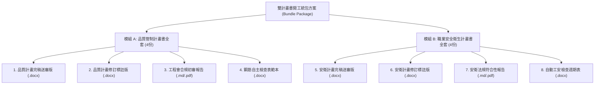

# 27｜品管與安衛「雙計畫書開工統包方案」與正式商業報價單

> **方案定位**：直擊公共工程開工審查最核心痛點——「**品質管制計畫書 ＋ 職業安全衛生管理計畫書 必須同時送審**」。  
> **核心價值**：**「一次委託、兩本搞定！48 小時內交付品管與安衛全套合規完稿，省去工務所雙倍熬夜心力！」**  
> **定價策略**：由單本 NT$ 1,800 躍升為雙本套裝 NT$ 3,200（原價 NT$ 6,500），客單價提升 78%，每小時貢獻毛利突破 NT$ 2,500/hr！

---

## 一、 營造廠開工審查「雙計畫書」剛性需求

依據公共工程委員會及各級政府採購契約規定，營造廠得標後於**開工前 30 日內**，必須同時繳交兩份重大法定送審文件經監造單位核定：

1. **《整體品質管制計畫書》**（依工程會 111 年底最新要點編製，含品管組織、材料抽驗總表、自主檢查表）。
2. **《職業安全衛生管理計畫書》**（依法規職安法及營造安衛標準編製，含危害辨識、防墜設施、自動檢查計畫）。

過去工務所常顧此失彼，品管過關但安衛被退件，導致開工報告無法核備動支。本專案推出**「品管＋安衛 雙計畫書統包服務」**，徹底解決工務所審查痛點！

---

## 二、 雙計畫書統包方案規格與交付物清單

委託本統包方案後，客戶將於約定時限內收到共 **8 份完整交付成果包**：



---

## 三、 正式商業報價單（對客報價梯次）

| 服務項目 | 包含規格 | 承諾交付時效 | 建議正式報價 (NTD) | 首批封測體驗價 (NTD) |
| :--- | :--- | :---: | :---: | :---: |
| **單本選購：品質管制計畫書** | 單本 80 頁內，工程會九大架構完稿 | 24 小時內 | NT$ 3,500 / 案 | **NT$ 1,800** |
| **單本選購：安衛管理計畫書** | 單本 60 頁內，職安法及營造安衛標準 | 24 小時內 | NT$ 3,000 / 案 | **NT$ 1,600** |
| **🏆 開工雙計畫書統包旗艦版** *(主力推薦)* | **品管 ＋ 安衛 雙本全套交付（共8份交付產物）** | **48 小時內** | **NT$ 6,500 / 套** | **NT$ 3,200 / 套**<br>*(現省 NT$ 3,300)* |
| **加急雙計畫書 (Express)** | 雙本計畫書排程加急 | **24 小時內極速交付** | NT$ 9,500 / 套 | **NT$ 5,000 / 套** |

---

## 四、 統包方案之財務效益與單位經濟測量

- **收入金額**：**NT$ 3,200 元**（首批封測優惠價）。
- **實質總投入工時**：
  - 品管計畫書處理：約 45 分鐘。
  - 安衛計畫書處理：約 30 分鐘。
  - 雙版本封裝與審查報告：約 10 分鐘。
  - **合計投入工時**：約 **85 分鐘（1.42 小時）**。
- **直接成本**：NT$ 0 元（本機純離線 Python 運算）。
- **每小時貢獻毛利（Margin/hr）**：
  $$\text{每小時貢獻毛利} = \frac{\text{NT\$ 3,200}}{1.42 \text{ 小時}} = \mathbf{\text{NT\$ 2,254 / hr}}$$
- **商業結論**：在維持超高每小時毛利（> NT$ 2,200/hr）的同時，**單案入帳金額直接從 NT$ 1,800 躍升至 NT$ 3,200**，成交 1 案即可達成一般兼職外包 3~4 天的獲利！

---

## 五、 現場私訊推介短文（專攻新接標案主管）

```text
[所長/學長] 您好：

恭喜貴所新標案順利得標開工！
開工前 30 天工務所最頭痛的就是「品質管制計畫書」跟「職業安全衛生計畫書」必須同時送審，新人光調格式跟法規條文就要改上整整一週。

我們團隊目前針對公共工程最新規定，推出了「品管 ＋ 安衛 雙計畫書開工統包排版服務」：
✅ 依據工程會 111 年底最新要點及現行職安法規校對完稿
✅ 跨頁表格表頭自動重複，目錄頁碼 100% 齊平
✅ 48 小時內交付雙計畫書完稿版、修訂標註版及合規初審報告

目前我們工區封測推廣期，原價 NT$ 6,500 的雙計畫書統包，首批體驗價只要 NT$ 3,200（兩本全包），而且承諾「驗收滿意再付款」！
如果手邊剛好有兩本計畫書正趕著送審，我這兩天幫您優先排程處理，讓工程師全力盯現場！謝謝您！
```
