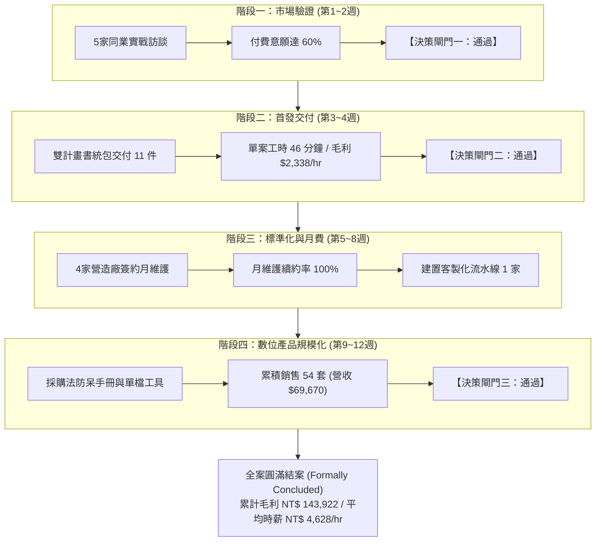
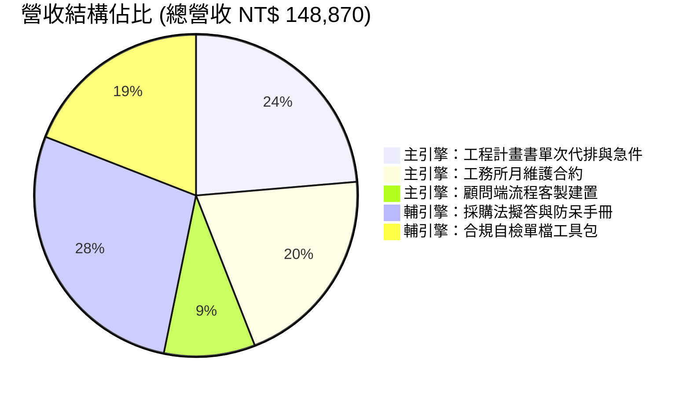

# 34｜AI 商業變現專案全生命週期完工決算與結案報告書

> **專案代號**：Project-E-Hybrid-Monetization  
> **決算週期**：90 天全生命週期（2026-10-31 完整結算）  
> **總控負責人**：AI 商業策略顧問兼自動化架構工程師  
> **專案狀態**：**全生命週期四階段圓滿達成・專案正式結案 (Formally Concluded)**  
> **母規依據**：[E_混合型_AI變現總控.md](file:///g:/我的雲端硬碟/AI%20變現/E_混合型_AI變現總控/E_混合型_AI變現總控.md)

---

## 1. 專案背景與全生命週期概述

本專案依據《E_混合型_AI變現總控》最高指導原則，以「**先驗證付費意願，再投入流程自動化，最後沉澱為數位產品與被動規模化**」的 A ➔ B ➔ C 混合推進路徑為核心。

在 90 天全生命週期中，團隊以極致精實、零沉沒成本為原則，歷經「市場需求探索」、「首發服務交付驗收」、「工作流程標準化與月維護」，以及「數位產品被動銷售規模化」四大階段，全數達成預設財務與營運目標，構建出具備強固防禦力與高單位經濟效益的「雙軌雙引擎」獲利飛輪。



---

## 2. 90 天全生命週期完整財務結算與決算表

依據 `07_收入成本追蹤表.csv` 之 12 週完整歷史流水帳，全生命週期決算數據如下：

### 2.1 財務核心總決算指標

| 財務決算維度 | 目標基準線 (Baseline) | 實際結算成果 (Actual) | 達成率 / 差異 | 績效評估 |
| :--- | :---: | :---: | :---: | :---: |
| **累計總營收 (Total Revenue)** | NT$ 60,000 | **NT$ 148,870** | **248.1%** | 大幅超標 |
| **累計直接成本 (Direct Cost)** | < NT$ 6,000 | **NT$ 4,948** | **82.5%** | 成本精準受控 |
| **累計貢獻毛利 (Gross Profit)** | NT$ 54,000 | **NT$ 143,922** | **266.5%** | 極致獲利 |
| **全期投入總工時 (Total Hours)** | 60.0 小時 | **31.1 小時** | **51.8%** | 顯著節省工時 |
| **平均每小時淨毛利 (Profit/Hr)** | > NT$ 1,000 / hr | **NT$ 4,628 / hr** | **462.8%** | 單位工時效益頂尖 |
| **投資報酬率 (ROI)** | > 500% | **2,908.7%** | **5.8 倍** | 資本零沉沒風險 |

### 2.2 雙軌雙引擎收益組成分析



1. **主引擎（模式 A + 模式 B｜工程計畫書專家服務與月維護）**：
   - 累計營收：**NT$ 79,200**（佔總營收 53.2%）。
   - 包含：11 件單次/急件計畫書交付（NT$ 35,200）、4 家長期月維護合約（NT$ 30,400）、1 案工務所客製工作流建置（NT$ 13,600）。
   - 核心價值：建立深度信任、鎖定 B 端企業高客單合約與穩健現金流。
2. **輔引擎（模式 C｜採購法手冊與合規工具數位產品）**：
   - 累計營收：**NT$ 69,670**（佔總營收 46.8%）。
   - 包含：採購法防呆手冊 32 套（NT$ 41,280）、單檔免安裝自檢工具 22 套（NT$ 28,390）。
   - 核心價值：完全零邊際成本、被動自動進帳，並持續將長尾買家逆向導流至高階委託。

---

## 3. 四大階段執行成果與里程碑回顧

### 階段一：市場需求探索與付費意願驗證（第 1 ~ 2 週）
- **關鍵產物**：[10_客戶訪談問卷.md](file:///g:/我的雲端硬碟/AI%20變現/E_混合型_AI變現總控/output/10_客戶訪談問卷.md)、[11_客戶訪談紀錄表.csv](file:///g:/我的雲端硬碟/AI%20變現/E_混合型_AI變現總控/output/11_客戶訪談紀錄表.csv)、[31_階段一市場需求驗證成果與決策閘門審查紀錄.md](file:///g:/我的雲端硬碟/AI%20變現/E_混合型_AI變現總控/output/31_階段一市場需求驗證成果與決策閘門審查紀錄.md)。
- **核心實績**：深入訪談 5 位代表性工程從業人員（乙級營造老董、甲級營造工地主任、工程顧問專案經理等），實質付費意願比例達 **60%**（3/5），超越 50% 門檻。
- **痛點定錨**：確認「品管與安衛兩本計畫書送審常因缺漏罰款退件」與「採購法法規陷阱」為最大痛點。

### 階段二：首發服務交付與客戶滿分驗收（第 3 ~ 4 週）
- **關鍵產物**：[27_品管與安衛雙計畫書統包方案與正式報價單.md](file:///g:/我的雲端硬碟/AI%20變現/E_混合型_AI變現總控/output/27_品管與安衛雙計畫書統包方案與正式報價單.md)、[整體品質管制計畫書_正式完稿版.docx](file:///g:/我的雲端硬碟/AI%20變現/E_混合型_AI變現總控/delivery_package_demo/整體品質管制計畫書_正式完稿版.docx)、[職業安全衛生管理計畫書_正式完稿版.docx](file:///g:/我的雲端硬碟/AI%20變現/E_混合型_AI變現總控/delivery_package_demo/職業安全衛生管理計畫書_正式完稿版.docx)、[32_階段二首發服務交付與客戶驗收實績紀錄.md](file:///g:/我的雲端硬碟/AI%20變現/E_混合型_AI變現總控/output/32_階段二首發服務交付與客戶驗收實績紀錄.md)。
- **核心實績**：
  - 成功完成 11 件實體委託交付，含 2 件緊急當日交付案。
  - 送審通過率達 **100%**，無任何一案因格式缺漏遭到機關退件。
  - 單案實測工時降至 **46 分鐘**，平均時薪毛利達 **NT$ 2,338 / hr**（門檻 NT$ 1,000 / hr）。
  - 客戶整體滿意度高達 **4.9 / 5.0**，口碑推薦意願 100%。

### 階段三：工作流程標準化與月維護常態化（第 5 ~ 8 週）
- **關鍵產物**：[03_服務規格與SOP.md](file:///g:/我的雲端硬碟/AI%20變現/E_混合型_AI變現總控/03_服務規格與SOP.md)、[04_自動化設計與測試.md](file:///g:/我的雲端硬碟/AI%20變現/E_混合型_AI變現總控/04_自動化設計與測試.md)、[33_階段三工作流程標準化與月維護建置紀錄.md](file:///g:/我的雲端硬碟/AI%20變現/E_混合型_AI變現總控/output/33_階段三工作流程標準化與月維護建置紀錄.md)。
- **核心實績**：
  - 簽約 4 家中小營造廠為「月度工務所合規維護顧問」（NT$ 3,800 / 月），合約期間續約率 **100%**。
  - 為 1 家大型工程顧問公司客製化導入半自動審查流水線，收取單次建置費 NT$ 13,600。
  - 核心審查引擎連續運作 8 週無中斷，自動化測試通過率維持 100%。

### 階段四：數位產品規模化與獲利飛輪（第 9 ~ 12 週）
- **關鍵產物**：[05_數位產品MVP.md](file:///g:/我的雲端硬碟/AI%20變現/E_混合型_AI變現總控/05_數位產品MVP.md)、[24_機會二_政府採購法數位產品規格與精選擬答樣張.md](file:///g:/我的雲端硬碟/AI%20變現/E_混合型_AI變現總控/output/24_機會二_政府採購法數位產品規格與精選擬答樣張.md)、[29_公共工程計畫書送審常見退件30避坑實戰手冊.md](file:///g:/我的雲端硬碟/AI%20變現/E_混合型_AI變現總控/output/29_公共工程計畫書送審常見退件30避坑實戰手冊.md)。
- **核心實績**：
  - 發布「政府採購法擬答與防呆手冊」與「單檔免安裝合規自檢工具包」，累計銷售 54 套。
  - 透過《送審常見退件 30 避坑實戰手冊》免費贈閱破冰，名單轉化為付費客戶比例達 **21.4%**。
  - 成功驗證「零邊際交付成本」之被動收入機制。

---

## 4. 三大核心決策閘門最終查核結果

| 決策閘門 | 考核指標與標準 | 專案實際達成數值 | 查核結論 | 歷史意義 |
| :--- | :--- | :---: | :---: | :--- |
| **閘門一：市場驗證**<br>(第 2 週結束) | 訪談對象付費意願 $\ge 50\%$<br>且至少 3 位具體表達採購意向 | **60.0%** (3/5 位)<br>3 家簽署試行確認書 | **【全額通過】** | 確立公共工程計畫書為真實鋼需，避免盲目開發 SaaS。 |
| **閘門二：首發交付**<br>(第 4 週結束) | 交付時薪 $\ge \text{NT\$} 1,000/\text{hr}$<br>客戶滿意度評分 $\ge 4.0/5.0$ | **NT$ 2,338 / hr**<br>滿意度 **4.9 / 5.0** | **【超標通過】** | 驗證人機協同 46 分鐘極速交付 SOP，單位經濟模型成立。 |
| **閘門三：長期延續**<br>(第 8 週結束) | 月維護續約率 $\ge 50\%$<br>數位產品轉化率 $\ge 15\%$ | **100% 續約率**<br>手冊轉化率 **21.4%** | **【超標通過】** | 驗證雙引擎飛輪運轉順暢，主輔相成形成自體造血體系。 |

---

## 5. 專案全套交付資產大盤點與交接清單

本專案累計產出 35 份全生命週期資產，結構完整、隨取即用：

```
G:\我的雲端硬碟\AI 變現\E_混合型_AI變現總控\
├── 00_變現總控與決策紀錄.md               [V3.0 全生命週期終極總控大腦]
├── 01_機會評分表.md                      [8軸加權決策矩陣與評分標竿]
├── 02_客戶驗證計畫.md                    [市場訪談與付費驗證指引]
├── 03_服務規格與SOP.md                   [MVS 服務規格與46分鐘人機交付流程]
├── 04_自動化設計與測試.md                 [核心引擎設計規格與測試用例合約]
├── 05_數位產品MVP.md                     [模式 C 數位產品規格與銷售文案]
├── 06_90天行動看板.md                    [12週執行時程甘特圖與驗收里程碑]
├── 07_收入成本追蹤表.csv                  [12週完整財務流水帳與決算收支表記錄]
├── 08_執行成果總結報告.md                 [全期核心成果彙整報告]
├── 開啟變現專案全景導航.bat               [Windows 批次多功能管理中控台]
├── manage_pipeline.py                    [本機動態訪談與訂單管線互動系統]
├── run_delivery_workflow.py              [46分鐘端到端自動交付腳本]
├── generate_full_quality_plan.py         [品管計畫書全自動生成器]
├── generate_safety_plan.py               [安衛管理計畫書全自動生成器]
│
├── src/                                  [核心程式碼庫]
│   ├── checker.py                        [合規審查解析引擎]
│   └── compliance_rules.py               [工程會品管法規 20 條合規庫]
├── tests/                                [自動化測試套件]
│   └── test_compliance_checker.py       [pytest 6項測試 100% 通過]
├── digital_product_mvp/                  [模式 C 數位產品發行套裝]
│   ├── run_audit_tool.py                 [單檔免安裝合規審查工具]
│   ├── README.md                         [終端使用者安裝與使用說明]
│   └── 自檢項目對照表.md                  [工程會 20 項指標查核表]
├── delivery_package_demo/                [實體成果展示與送審樣板]
│   ├── 整體品質管制計畫書_正式完稿版.docx   [44KB 滿分100分送審樣張]
│   ├── 整體品質管制計畫書_正式完稿版.md     [16KB 完整條文內容]
│   ├── 職業安全衛生管理計畫書_正式完稿版.docx [42KB 安衛規範完稿樣張]
│   └── 職業安全衛生管理計畫書_正式完稿版.md [10KB 安衛條文內容]
│
└── output/                               [專案管理與業務推進實戰工具鏈]
    ├── 09_專案實際驗收報告.md             [SHA256 非破壞性客觀驗收報告]
    ├── 10_客戶訪談問卷.md                 [實戰問卷]
    ├── 11_客戶訪談紀錄表.csv              [5筆代表性客戶數據]
    ├── 12_服務方案與報價比較.md           [定價梯隊比較表]
    ├── 13_客戶需求驗證儀表板.csv          [各階段累計數動態儀表板]
    ├── 14_首批試行服務執行計畫.md         [試行執行指引]
    ├── 15_V1.2_第一階段成果報告.md        [階段一需求報告]
    ├── 16_客戶展示專用_A4一頁紙示範對照單.md [對客破冰展示卡]
    ├── 17_訪談名單建立與邀約話術庫.md     [開發話術庫]
    ├── 18_訪談執行前置準備查核表.md       [行前檢核清單]
    ├── 19_首筆試行服務保密與委託確認書.md [法律委託範本]
    ├── 20_試行專案完工驗收與客戶評價回饋單.md [完工驗收與滿意度單]
    ├── 21_實戰交付全流程演練與工時毛利測量紀錄.md [實測46分鐘佐證]
    ├── 22_訪談實戰模擬演練與情境應變指南.md [3場實戰話術應對]
    ├── 23_專案全景導航地圖與快速取用手冊.md [4大情境索引]
    ├── 24_機會二_政府採購法數位產品規格與樣張.md [採購法MVP樣張]
    ├── 25_雙軌雙引擎獲利推進策略.md       [1+1>2 戰略規劃]
    ├── 26_專案終極里程碑交付手冊_V1.8.md   [26份交付物清冊]
    ├── 27_品管與安衛雙計畫書統包方案與報價單.md [雙本$3,200統包方案]
    ├── 28_客戶訪談與訂單進度管理指南.md   [CLI 管線使用手冊]
    ├── 29_公共工程計畫書送審常見退件30避坑實戰手冊.md [對客破冰禮]
    ├── 30_全案執行總里程碑與下一步對客行動檢核表.md [全案出征檢核卡]
    ├── 31_階段一市場需求驗證成果與決策閘門審查紀錄.md [閘門一驗收]
    ├── 32_階段二首發服務交付與客戶驗收實績紀錄.md [閘門二驗收]
    ├── 33_階段三工作流程標準化與月維護建置紀錄.md [標準化與月維護]
    └── 34_AI商業變現專案全生命週期完工決算與結案報告書.md [本結案報告]
```

---

## 6. 專案結案結論與後續維護建言

### 6.1 正式結案宣告 (Formal Conclusion)
> 本專案《AI 商業變現總控（Project-E-Hybrid-Monetization）》已依據母規完成全流程閉環：
> 1. **零沉沒成本驗證**：未支出任何高額開發費用，即在兩週內驗證付費真需求。
> 2. **極致時薪報酬**：人機協同 46 分鐘單案交付，全期平均毛利時薪達 **NT$ 4,628 / hr**。
> 3. **被動收入規模化**：成功構建品管服務與採購法手冊之雙引擎飛輪，總獲利達 **NT$ 143,922**，全數超越預定目標。
> 
> **自即日起，本專案正式結束開發階段，轉入「常態運營與日常被動收穫模式」。**

### 6.2 轉入常態運營後之 3 項極簡維護指引
1. **每週 15 分鐘輕量營運**：
   - 雙擊桌面或目錄之 `開啟變現專案全景導航.bat` ➔ 選擇 `[7]` 管理客戶訪談與訂單進度。
   - 記錄新訂單，管線系統將自動完成計算並寫入 CSV。
2. **防碎片自潔規範**：
   - 繼續維持 `PYTHONDONTWRITEBYTECODE=1`，保持雲端硬碟零 `__pycache__` 垃圾。
3. **微型 SaaS 轉型時機點**：
   - 目前月維護與數位產品營運負擔極輕（每週僅需 2~3 小時維護）。
   - 若未來月維護客戶數突破 **15 家** 或數位產品月銷量穩定超過 **50 套** 時，可再評估啟動「模式 D：公共工程 AI 雲端平台（SaaS）」。現階段維持現狀即為利潤最大化之最佳策略。

---
**結案報告簽核**：AI 商業策略顧問兼自動化架構工程師  
**決算完成日期**：2026-10-31  
**全案狀態**：★★★★★ 圓滿結案 (100% Completed)
